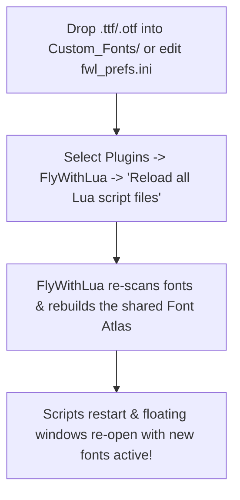

# FlyWithLua Dear ImGui Font Guide

**FlyWithLua 2.8.18+ / 2.8.19 -- ImgWindow v2.2.1+ -- Dear ImGui 1.92.8**  
*A Developer & User Guide to Scalable Fonts, Custom Typefaces, and the Named Font Registry*

> **October 21, 2026**  
> **Authors:** William Good & Steven L. Goldberg (`@slgoldberg`), with help from Google Gemini  
> **Target Release:** FlyWithLua 2.8.18+ / 2.8.19 (Built against Dear ImGui 1.92.8 & ImgWindow v2.2.1 Panel Graphics)

---

FlyWithLua provides powerful support for **Dear ImGui** floating windows. Starting with FlyWithLua 2.8.18, script authors have access to high-resolution scalable TrueType (`.ttf`) and OpenType (`.otf`) fonts, a modern **Named Font Registry**, and live mid-flight font reloading.

This guide explains both the **Modern Named Font Registry** (recommended for new scripts) and the **Legacy Slot System** (preserved for 100% backward compatibility).

---

## 1. Quick Comparison

| Feature | Legacy Slot System | Modern Named Font Registry |
| :--- | :--- | :--- |
| **Syntax** | <nobr>`imgui_push_font(1..9)`</nobr> | <nobr>`imgui.PushFont("Roboto-Regular-16")`</nobr> |
| **Font Identification** | Arbitrary integer slot (1–9) | Human-readable string or alias |
| **Adding New Fonts** | Replaces slots 1–9 via INI | Drop into folder or add `Font.<Alias>` in INI |
| **Dynamic Sizing** | Fixed to 3 predefined INI sizes | Any size at runtime: <nobr>`imgui.PushFont("Roboto-Regular", 24)`</nobr> |
| **Missing Font Handling** | Silently ignored (crashes on `PopFont`) | Warns & falls back to rescaled default font |
| **Reloading Fonts** | Requires full sim or plugin reload | **Live mid-flight reload** via FlyWithLua menu |
| **Pop Function** | <nobr>`imgui.PopFont()`</nobr> | <nobr>`imgui.PopFont()`</nobr>, <nobr>`imgui.pop_font()`</nobr>, or <nobr>`imgui_pop_font()`</nobr> |

---

## 2. The Modern Named Font Registry (Recommended)

### 2.1 Using Named Fonts in Lua
To format text with a specific font weight and size, wrap your text calls between `imgui.PushFont()` and `imgui.PopFont()`:

```lua
-- Standard syntax (matching Dear ImGui):
imgui.PushFont("Roboto-Medium-20")
imgui.TextUnformatted("Cockpit Checklist")
imgui.PopFont()

-- Standard body text:
imgui.PushFont("Roboto-Regular-16")
imgui.TextUnformatted("All systems normal.")
imgui.PopFont()
```

> [!NOTE]
> FlyWithLua supports all common casing styles interchangeably:
> - `imgui.PushFont(...)` / `imgui.PopFont()` (PascalCase, standard Dear ImGui)
> - `imgui.push_font(...)` / `imgui.pop_font()` (snake_case, FlyWithLua convention)
> - `imgui_push_font(...)` / `imgui_pop_font()` (global legacy alias)

---

### 2.2 Standard Bundled Fonts & Built-In Defaults
FlyWithLua includes high-quality TrueType fonts pre-baked into the shared font atlas:

| Font Name / Alias | Style | Default Baked Sizes |
| :--- | :--- | :--- |
| `"Roboto-Light"` | Light / Clean | `13px`, `16px`, `20px` (e.g. `"Roboto-Light-13"`) |
| `"Roboto-Regular"` | Standard Regular | `13px`, `16px`, `20px` (e.g. `"Roboto-Regular-16"`) |
| `"Roboto-Medium"` | Semi-Bold / Header | `13px`, `16px`, `20px` (e.g. `"Roboto-Medium-20"`) |
| `"ProggyClean"` | Pixel Bitmap Font | `13px` fixed (Classic ImGui embedded font) |
| `"ProggyForever"` | Scalable Vector Font | Scalable default font |
| `"default"` | Active Default Font | Points to the primary default font |

*If you request a base name without a size (e.g. `imgui.PushFont("Roboto-Regular")`), FlyWithLua automatically uses the primary size (`ImguiFontSize1`, default 13px).*

---

### 2.3 Dynamic Point-Size Rescaling at Runtime
You are not limited to pre-baked sizes. You can pass a point size as an optional second argument:

```lua
-- Dynamically scale Roboto-Regular to 26px:
imgui.PushFont("Roboto-Regular", 26)
imgui.TextUnformatted("26px Dynamic Heading")
imgui.PopFont()
```

---

### 2.4 Adding Your Own Fonts

You have two simple ways to add custom fonts:

#### Method A: Zero-Config Folder Drop-In (Simplest)
1. Copy any TrueType (`.ttf`) or OpenType (`.otf`) file into:
   ```
   Resources/plugins/FlyWithLua/Custom_Fonts/
   ```
2. FlyWithLua automatically discovers the file, builds it into the font atlas at the 3 standard sizes (`13`, `16`, `20`), and registers it under its filename stem.
3. For example, dropping `Ubuntu-Bold.ttf` into the folder makes all of these immediately available:
   - `"Ubuntu-Bold-13"`
   - `"Ubuntu-Bold-16"`
   - `"Ubuntu-Bold-20"`
   - `"Ubuntu-Bold"` (primary size)
   - Or dynamic scaling: `imgui.PushFont("Ubuntu-Bold", 32)`

#### Method B: Custom INI Aliases & Custom Sizes
You can define semantic font nicknames and custom pixel sizes in `Resources/plugins/FlyWithLua/fwl_prefs.ini`:

```ini
; -----------------------------------------------------------------------------
; Custom Named Font Definitions
; Format: Font.<AliasName> = <FontFileName.ttf>, <SizeInPixels>
; -----------------------------------------------------------------------------
Font.HUD        = DSEG7Classic-Regular.ttf, 28
Font.Title      = Roboto-Medium.ttf, 24
Font.TinyLabel  = Roboto-Light.ttf, 11
```

In your script, simply call:
```lua
imgui.PushFont("HUD")
imgui.TextUnformatted("124.850")
imgui.PopFont()

imgui.PushFont("Title")
imgui.TextUnformatted("Navigation Display")
imgui.PopFont()
```

---

### 2.5 Querying Available Fonts in Lua
Scripts can dynamically discover all registered font names at runtime using `imgui.get_font_list()`:

```lua
local fonts = imgui.get_font_list()
for index, font_name in ipairs(fonts) do
    imgui.PushFont(font_name)
    imgui.TextUnformatted(string.format("%s: The quick brown fox", font_name))
    imgui.PopFont()
end
```

---

## 3. The Legacy Slot System (100% Backward Compatible)

FlyWithLua preserves complete compatibility with scripts written for William Good's original 9-slot integer font system.

### 3.1 Legacy Usage
```lua
imgui_push_font(1) -- Select font slot 1
imgui.TextUnformatted("Text in Slot 1")
imgui.PopFont()

imgui_push_font(5) -- Select font slot 5
imgui.TextUnformatted("Text in Slot 5")
imgui.PopFont()
```

### 3.2 Legacy Slot Mapping Table
By default, the 9 integer slots are pre-configured as follows:

| Slot Number | Font File | Default Size | Description |
| :---: | :--- | :---: | :--- |
| **1** | `Roboto-Light.ttf` | 13px | Font 1, Size 1 |
| **2** | `Roboto-Light.ttf` | 16px | Font 1, Size 2 |
| **3** | `Roboto-Light.ttf` | 20px | Font 1, Size 3 |
| **4** | `Roboto-Regular.ttf` | 13px | Font 2, Size 1 |
| **5** | `Roboto-Regular.ttf` | 16px | Font 2, Size 2 |
| **6** | `Roboto-Regular.ttf` | 20px | Font 2, Size 3 |
| **7** | `Roboto-Medium.ttf` | 13px | Font 3, Size 1 |
| **8** | `Roboto-Medium.ttf` | 16px | Font 3, Size 2 |
| **9** | `Roboto-Medium.ttf` | 20px | Font 3, Size 3 |

### 3.3 Legacy INI Configuration (`fwl_prefs.ini`)
To alter the sizes or files assigned to slots 1–9, configure these keys in `fwl_prefs.ini`:

```ini
; Font sizes for slots (1, 4, 7), (2, 5, 8), and (3, 6, 9)
ImguiFontSize1 = 13
ImguiFontSize2 = 16
ImguiFontSize3 = 20

; Set to 1 to replace Roboto with custom fonts for slots 1-9
UseCustomFonts = 0

ImguiCustomFont1 = Roboto-Light.ttf   ; Used for slots 1, 2, 3
ImguiCustomFont2 = Roboto-Regular.ttf ; Used for slots 4, 5, 6
ImguiCustomFont3 = Roboto-Medium.ttf  ; Used for slots 7, 8, 9
```

> [!TIP]
> Even if `UseCustomFonts = 1` is enabled to customize slots 1–9, FlyWithLua automatically keeps the standard bundled Roboto fonts loaded and accessible by name (`"Roboto-Regular-16"`, etc.) so that other community scripts never break!

---

## 4. Stack Safety & Crash Protection

In raw Dear ImGui, mismatched font calls can crash X-Plane. FlyWithLua incorporates rigorous safeguards:

### 4.1 Missing Font Fallback & Automatic Rescaling
If a script requests a font name or slot index that doesn't exist:
1. FlyWithLua extracts the requested size (e.g. from `"MissingFont-24"` or `imgui.PushFont("Ghost", 24)`).
2. It logs a friendly developer warning to `Log.txt`:
   ```
   FlyWithLua Warning: imgui.PushFont: Font 'MissingFont-24' not found, falling back to default font @ 24px.
   ```
3. It **pushes the default font rescaled to the requested point size**.
4. **Why this matters:** Because a font was pushed, the script's subsequent `imgui.PopFont()` call succeeds without a stack underflow assertion, and your UI layout preserves its intended proportions.

### 4.2 Empty Stack Guard (`PopFont`)
If a script mistakenly calls `imgui.PopFont()` more times than `PushFont()`:
- Raw ImGui triggers an unrecoverable assertion (`IM_ASSERT(g.FontStack.Size > 0)`).
- FlyWithLua verifies `ctx->FontStack.Size > 0` before popping. If empty, it logs a warning and returns cleanly, completely preventing simulator crashes.

---

## 5. Live Mid-Flight Font Reloading

You **do not need to restart X-Plane** or reload all simulator plugins when adding fonts or modifying configurations!

### Why a Reload is Needed (The Shared Font Atlas)
Dear ImGui renders text using a single, unified GPU texture known as the **Font Atlas**. In FlyWithLua, all floating windows share this single font atlas so that memory usage remains minimal and rendering stays ultra-fast. Because all available fonts and sizes are compiled into this shared atlas when FlyWithLua initializes, any time you drop a new font into `Custom_Fonts/` or change font sizes or aliases in `fwl_prefs.ini`, FlyWithLua needs to rebuild that shared atlas so your scripts can immediately use the new glyphs.



### The 4-Step Font Workflow

1. **Add Your Font File:**  
   Copy any TrueType (`.ttf`) or OpenType (`.otf`) file into:
   ```
   Resources/plugins/FlyWithLua/Custom_Fonts/
   ```
2. **(Optional) Configure Aliases or Custom Sizes:**  
   If you want a custom pixel size or a shorthand alias name, open `Resources/plugins/FlyWithLua/fwl_prefs.ini` and add your entry (e.g. `Font.HUD = MyFont.ttf, 28`). If you skip this, FlyWithLua automatically registers the font at standard sizes (`13`, `16`, `20`) using its filename stem.
3. **Trigger the Live Reload:**  
   In X-Plane's top menu bar, simply select:  
   **Plugins &rarr; FlyWithLua &rarr; Reload all Lua script files**
4. **Immediate Mid-Flight Refresh:**  
   Within a single simulator frame, FlyWithLua closes any open floating windows, re-scans your font folders, rebuilds the shared font atlas, and re-executes your scripts. Your windows re-open with your new fonts immediately active!

> [!TIP]
> **Scripting Tip for Smooth Reloads:** Because reloading scripts closes and re-opens floating windows, having your script remember its open state or position ensures a seamless live-editing workflow while tweaking fonts mid-flight!

---

## 6. Complete Demo Script

A complete, working reference script is included in your FlyWithLua installation at:
[`Resources/plugins/FlyWithLua/Scripts (disabled)/imgui_named_fonts_demo.lua`](file:///Users/brat/Documents/FlyWithLua-pg-test/FlyWithLua/Scripts%20(disabled)/imgui_named_fonts_demo.lua)

Copy it to your `Scripts/` folder to explore all the features in real time!
