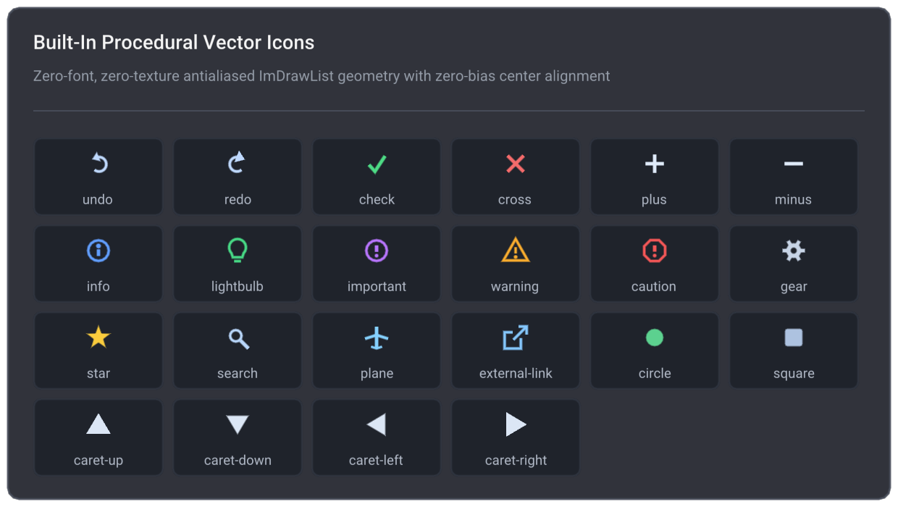
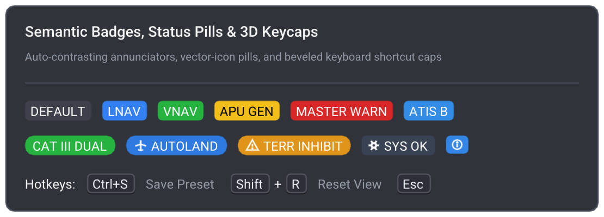
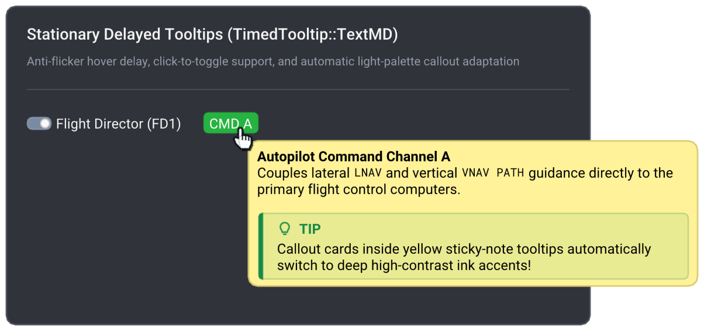
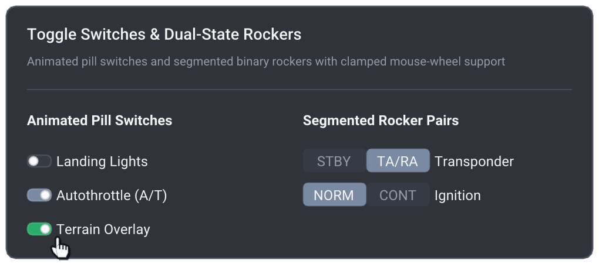
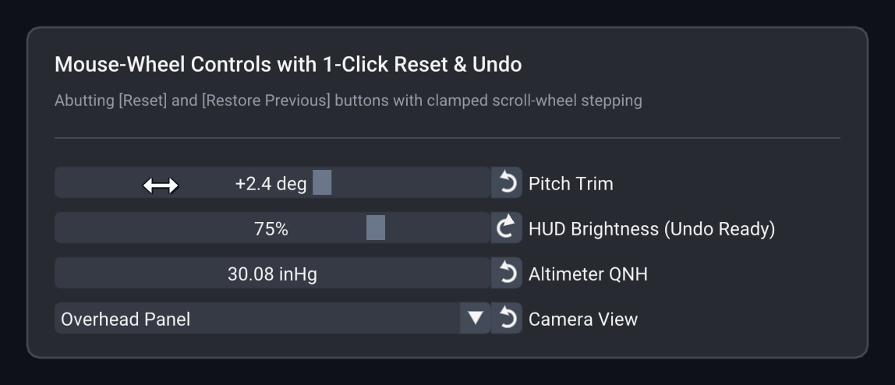
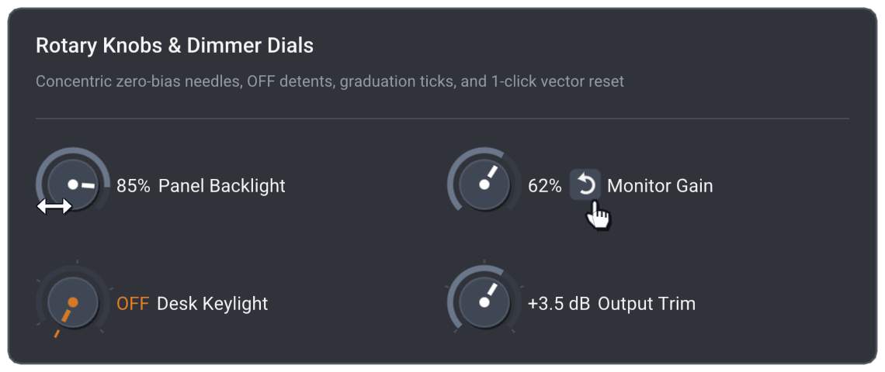
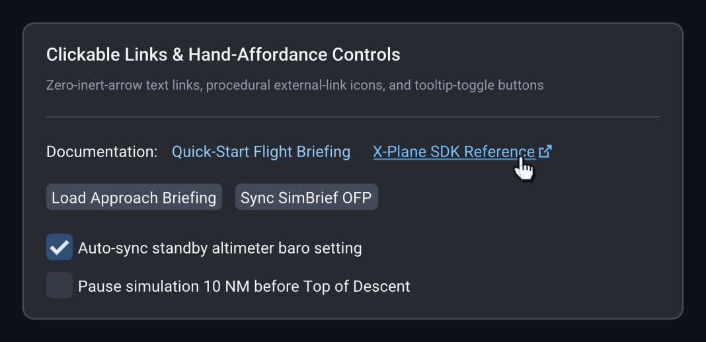
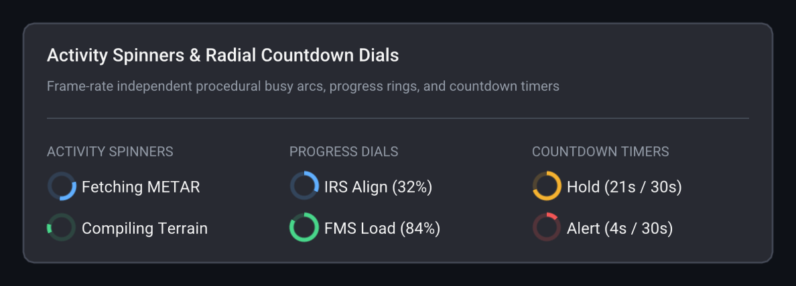
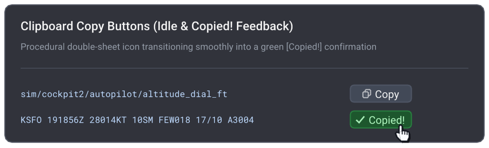
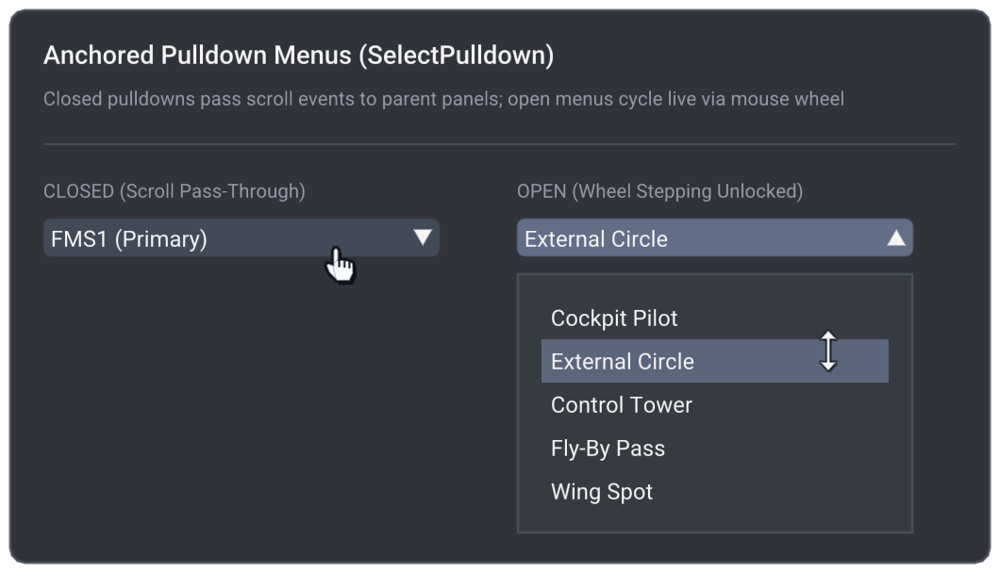

# FlyWithLua LuiGee Modern UI & Flight-Deck UX Guide

**FlyWithLua 2.8.20+ -- ImGee v1.1.0 Suite -- ImgWindow v2.5 -- Dear ImGui 1.92.8**  
*Illustrated Developer & User Manual for Markdown, TimedTooltip, Tactile Widgets, Typography, and In-Sim Document Viewers*

> **November 2026**  
> **Author:** Steven L. Goldberg (`@slgoldberg`) and the Rogers  
> **Target Release:** FlyWithLua 2.8.20+ (Built against Dear ImGui 1.92.8 & ImGee Suite v1.1.0 / ImgWindow v2.5)


---

## 1. Overview & Architecture

FlyWithLua integrates **LuiGee** (*"The Lua Companion to ImGee"*), bringing modern immediate-mode UI ergonomics directly into Lua scripts across X-Plane 11.20+ and X-Plane 12+. Instead of flat debug panels, missing Unicode `?` boxes, and jittery cursor-chasing tooltips, script authors get physical toggle switches, 270-degree rotary dimmer dials, 1-click Reset-with-Undo sliders and combos, stationary Markdown tooltips, 2x-sharp procedural vector icons, and turnkey in-cockpit manual windows with zero C++ boilerplate.

All bindings live natively in `src/FloatingWindows/FWLImGeeBindings.cpp` and `FWLDocWindow.h`, bridging Lua scripts directly to `ImgWindow` and `ImGee`.

> [!TIP]
> **Read This Manual Live Inside X-Plane:** Open `Plugins > FlyWithLua > FlyWithLua Macros > FlyWithLua: LuiGee User Guide (Live Manual)` (or click **User Guide** in `ImGui_LuiGee_Demo.lua`) to browse this exact `.md` document in a live `ImgDocWindow` -- complete with instant Table-of-Contents jumping, glass HUD opacity, 5 color themes, and click-to-enlarge zoom/pan image lightboxes!

### Key Capabilities
- **Rich CommonMark & GFM Markdown (`imgui.MD`):** Headings, tristate sortable/resizable GFM tables, all five GFM callout cards (`> [!NOTE]` .. `[!CAUTION]`), fenced code blocks with 1-click `[Copy]`, and 3-tier images (memory, disk, async HTTP/HTTPS) with text-wrapping floats and zoom/pan lightboxes.
- **Turnkey In-Sim Manual Viewers (`imgui.DocWindow` & `imgui.DocumentViewer`):** Point a prefab `ImgDocWindow` at any `.md` manual in 3 lines of Lua to get an instant glass X-Plane help window with TOC section jump, 1-click scroll return, proportional zoom, Pop-Out/VR support, and disk `mtime` hot-reload.
- **Stationary Adaptive Tooltips (`imgui.TimedTooltip`):** Hover-delayed sticky-note tooltips with viewport clamping, damped zoom scaling, click-to-toggle support on links and read-only indicators, and embedded Markdown.
- **Tactile Widgets & Active Cursors:** Animated `ToggleButton` switches, `Knob` / `DimmerKnob` potentiometers with two-step `OFF` detents, mouse-wheel sliders/drags/combos with 1-click A/B Reset-with-Undo (`↺` / `↻`), upward-blossoming `SelectPulldown` menus with Lens UI tooltip latching, and non-blocking in-sim file dialogs.
- **Semantic Typography & Themes:** 9-slot `ImFontRole` hierarchy, baseline-aligned inline `StyledText` (`<tiny>`, `<small>`, `<big>`, `<huge>`, `<mono>`), zero-disk `RegisterMemoryImage` textures, and curated `Charcoal` and `Rusty` color palettes.


### Orientation Roadmap
- **[2. Markdown Extension (`imgui.Markdown` / `MD`)](#2-markdown-extension-imguimarkdown--md)** -- CommonMark prose, vector icons, sortable GFM tables, fenced code blocks, callouts, and floated/lightbox figures.
- **[3. Inline Styling: Pills, Badges, Keys & Colors](#3-inline-styling-pills-badges-keys--colors)** -- Auto-contrasting `<pill>`, `<badge>`, `<kbd>`, `#rrggbbaa` colors, and declarative custom tags.
- **[4. TimedTooltip Extension (`imgui.TimedTooltip`)](#4-timedtooltip-extension-imguitimedtooltip--timedtooltip)** -- Stationary delayed tooltips, click-to-toggle indicators, and font-scale policies.
- **[5. Modern LuiGee Widgets](#5-modern-luigee-widgets)** -- Toggles, wheel sliders/combos with Reset/Undo, rotary knobs, links, spinners, copy buttons, and file dialogs.
- **[6. Dynamic ImGui Mouse Cursors](#6-dynamic-imgui-mouse-cursors)** -- Automatic `Hand`, `ResizeEW`, `ResizeNS`, and `TextInput` cursor affordances.
- **[7. Popups, Pulldowns, Typography & Themes](#7-directional-popups-pulldowns-typography--themes)** -- `SelectPulldown`, `OpenPopupAtItem`, `StyledText`, `FontRole`, memory images, `ZoomableViewport`, and themes.
- **[8. Turnkey In-Sim Manual Viewers (`DocWindow` & `DocumentViewer`)](#8-turnkey-in-sim-manual-viewers-imguidocwindow--imguidocumentviewer)** -- Prefab `ImgDocWindow` help windows and embedded `DocumentViewer` panels.
- **[9. Universal C++ & Lua Alias Matrix](#9-universal-c--lua-alias-matrix)** -- Complete PascalCase, shorthand, and `snake_case` lookup table.
- **[10. Complete Interactive Script Recipe](#10-complete-interactive-script-recipe)** & **[11. Bundled Demo Scripts](#11-bundled-demonstration-scripts--add-ons)**.

---

## 2. Markdown Extension (`imgui.Markdown` / `MD`)

The Markdown extension parses standard Markdown syntax and renders it as native Dear ImGui draw commands within the current window.

### Semantic Font Auto-Wiring
The Markdown system automatically hooks into FlyWithLua's **Named Font Registry**:

| Markdown Element | Target Font Name | Fallback Font | Visual Style |
| :--- | :--- | :--- | :--- |
| **Heading 1** (`#`) | `Roboto-Medium-20` | `Roboto-Medium`, Default | 20px Bold / Underlined |
| **Heading 2** (`##`) | `Roboto-Medium-16` | `Roboto-Medium`, Default | 16px Bold / Underlined |
| **Heading 3** (`###`) | `Roboto-Medium-16` | `Roboto-Medium`, Default | 16px Bold |
| **Bold** (`**bold**`) | `Roboto-Medium` | `Roboto-Regular`, Default | Medium / Semi-Bold weight |
| **Italics** (`*italic*`) | `Roboto-Italic-16` | `Roboto-Italic`, `Roboto-Light` | True Italic / Slanted weight |
| **Monospace / Code** (`code`) | `RobotoMono-Regular-16` | `RobotoMono-Regular`, `ProggyForever` | Scalable Monospace font |

*(Note: True italic and scalable monospace typographies are powered by `Roboto-Italic.ttf` and `RobotoMono-Regular.ttf`, bundled directly in `FlyWithLua/Custom_Fonts/`. If not present, the engine gracefully falls back to `Roboto-Light` or `ProggyForever`).*

### Markdown Functions

#### `imgui.Markdown.Text(format_string, ...)`
Renders formatted Markdown text. Supports variadic arguments.
```lua
imgui.Markdown.Text("# Pre-Flight Inspection")
imgui.Markdown.Text("Verify engine oil pressure: **%.1f PSI** (Nominal: %d-%d PSI)", oil_psi, 45, 60)
```

#### `imgui.Markdown.TextWrapped(format_string, ...)`
Renders formatted Markdown text with automatic line wrapping to the current window boundary.
```lua
imgui.Markdown.TextWrapped("This is a long flight briefing paragraph that wraps smoothly across the window...")
```

#### `imgui.Markdown.TextUnformatted(string)`
Renders Markdown text directly without variadic format parsing (safe for strings containing arbitrary `%` characters).
```lua
imgui.Markdown.TextUnformatted("Direct text containing 100% pure data.")
```

#### `imgui.Markdown.ButtonMD(label, [tooltip], [wrap_width])`
Renders an interactive push button supporting procedural vector icons, shortcodes, Unicode glyphs, hand cursor on hover, and rich Markdown tooltips.
- **Procedural Vector Icons:** Automatically renders vector geometry directly on the button face via XML tags (`<icon caret-up />`), shortcodes (`:undo:`), raw Unicode (`▲`, `↺`), or link macros (`#[^](ICON_CARET_UP)`).
- **Auto-Centering:** Centers the icon and text dynamically, maintaining crisp layout on any font atlas.

```lua
-- Vector icon + text button:
if imgui.Markdown.ButtonMD("Quick Actions <icon caret-up />##btn", "**Quick Actions**\n\nFlight deck snippets menu") then
    toggle_quick_actions()
end

-- Pure icon button:
if imgui.Markdown.ButtonMD("<icon caret-up />##scroll_top", "Scroll to top") then
    scroll_top()
end
```

#### Dedicated Vector Icons & Icon Buttons



- `imgui.Icon(icon_name, [size], [color], [tooltip])`: Draws a standalone antialiased vector icon inline (`"plane"`, `"compass"`, `"gear"`, `"check"`, `"warning"`, `"lightbulb"`, `"important"`, `"caution"`, `"undo"`, `"copy"`, `"external-link"`, etc.). Clicking an icon with a trailing `TimedTooltip` pins or dismisses the tooltip.
- `imgui.IconButton(str_id, icon_name, [w, h], [tooltip], [icon_color]) -> clicked`: Pure vector icon button auto-sized to a crisp square.
- `imgui.ButtonIcon(label, icon_name, [w, h], [icon_on_right], [tooltip], [icon_color]) -> clicked`: Button with both procedural vector icon and text.
- `imgui.IsVectorIcon(icon_name) -> bool` and `imgui.NormalizeIconName(name) -> canonical_name`: Query or normalize icon names and aliases.

<br clear="all"/>

```lua
imgui.Icon("plane", 16, "#5dade2", "Active aircraft profile")
imgui.SameLine()
if imgui.IconButton("##up_arrow", "caret-up", 0, 0, "Move Note Up") then
    move_note_up()
end

if imgui.ButtonIcon("Settings", "gear", 0, 0, false, "Configure Cockpit Notes") then
    open_settings()
end
```

#### Interactive GFM Tables (Tristate Sorting & Resizable Columns)
Standard GitHub Flavored Markdown pipe tables (`| Col A | Col B |`) automatically render with **tristate column sorting** (click any header to cycle Ascending -> Descending -> Original order), **drag-resizable column dividers**, **right-edge table width grips**, and context-aware `TimedTooltip` hints (`imgui.MD.SetEnableTableTooltips(true)`):


#### `imgui.Markdown.DelayedTooltipMD(markdown_str, [wrap_width])` and `clicked = imgui.Markdown.TextLink(format_string, ...)`
- `DelayedTooltipMD` (also on root `imgui.DelayedTooltipMD`): Attaches a delayed rich Markdown tooltip directly to the preceding item.
- `Markdown.TextLink` (`imgui.TextMDLink`): Renders inline Markdown text with a pointing-hand hover cursor and click detection (plus click-to-toggle `TimedTooltip` support).

#### `width, height = imgui.Markdown.CalcTextSize(text, [wrap_width], [font_scale])`
Calculates the pixel dimensions required to render a given Markdown string before drawing (also aliased as `imgui.Markdown.CalcSize` and `imgui.CalcMarkdownSize`).
```lua
local w, h = imgui.Markdown.CalcTextSize("### Heading Example", 360, 1.0)
```

---

## 3. Inline Styling: Pills, Badges, Keys & Colors



FlyWithLua supports inline XML-style tags embedded directly inside Markdown text (as well as standalone immediate-mode widgets in Section 5):

### 1. Status Pills (`<pill color>TEXT</pill>`)
Pills render rounded, solid-colored badges with auto-contrasting text -- ideal for system annunciators and warning flags.

Supported color keywords: `green`, `red`, `blue`, `yellow`, `orange`, `purple`, `gray`, `error`, `warning`, `caution`, `info`, `success`.

Pills and badges also natively support embedded icons via `icon=`, `img=`, or `image=`, as well as self-closing unary annunciators (`<pill icon=... />`).

<br clear="all"/>

```lua
imgui.MD.Text("Hydraulics: <pill green>SYSTEM NORMAL</pill> | Fuel Tank A: <pill warning>LOW LEVEL</pill>")
-- Embedded icon pill:
imgui.MD.Text("Autopilot: <pill icon=avionics_beacon color=#3498db>NAV / ALT</pill>")
-- Self-closing unary annunciator:
imgui.MD.Text("Master Caution: <pill icon=avionics_beacon color=#e74c3c />")
```

### 2. Version & Topic Badges (`<badge color>TEXT</badge>`)
Badges render slightly more subtle categorized chips for metadata, build tags, and feature markers.

```lua
imgui.MD.Text("FlyWithLua <badge blue>v2.8.20</badge> running on <badge purple>Metal / Vulkan</badge>")
imgui.MD.Text("Firmware: <badge icon=avionics_beacon>v2.3.0</badge>")
```

### 3. Keyboard Shortcut Tags (`<kbd>Key</kbd>`)
Renders a bordered, keycap-styled box for visual keyboard shortcuts.

```lua
imgui.MD.Text("Press <kbd>Shift</kbd> + <kbd>Ctrl</kbd> + <kbd>R</kbd> to reload Lua scripts.")
```

### 4. Custom Hex Colors & Alpha Transparency (`#rgb`, `#rgba`, `#rrggbb`, `#rrggbbaa`)
Colors arbitrary text spans, pills, badges, or style definitions using standard web hexadecimal notation with optional alpha transparency:
* `#rgb` (12-bit RGB, opaque)
* `#rgba` (16-bit RGBA with 4-bit alpha)
* `#rrggbb` (24-bit RGB, opaque)
* `#rrggbbaa` (32-bit RGBA with full 8-bit alpha)

```lua
imgui.MD.Text("Target speed: <color #00bc8c>250 knots</color> below <color #f39c12>10,000 ft</color>.")
imgui.MD.Text("Translucent overlay: <pill #3498db88>TRANSLUCENT PILL</pill>")
```

#### Smart Capsule Auto-Contrast & Decoupled Backgrounds
* **Automatic Contrast:** When passing a bare color keyword or hex code into `<pill>` or `<badge>` (e.g. `<pill #ff4444>`), ImGee calculates the background color luminance and automatically renders the enclosed text in crisp, readable high-contrast black or white.
* **Decoupled Text & Background:** When specifying an explicit `bg=` or `bgcolor=` (e.g. `<style fg=#ffffff bg=#88888840>`), the text foreground color is strictly preserved and decoupled from the background fill box.
* **Recursive Tag Nesting:** Style tags can be nested recursively within other tags (e.g. `<style green bold>Exterior: <style yellow>WARN</style> Clear</style>`).

### 5. Declarative Semantic Style Tags & Macro Aliases
Rather than repetitively writing verbose formatting strings or nesting raw XML tags across scripts, developers can define custom semantic Markdown tags dynamically during script initialization:

#### 1. Semantic Style Tags (`imgui.RegisterStyleTag`)
Maps a custom tag name to a composite typography style combining colors, weights, fonts, and background capsules:

```lua
-- Define semantic tags during script startup:
imgui.RegisterStyleTag("cam", "green bold mono")
imgui.RegisterStyleTag("viewmode", "mono bg=#88888840")
imgui.RegisterStyleTag("alert", "bg=#ff4444 fg=#ffffff bold")

-- Use seamlessly inside any Markdown or StyledText:
imgui.MD.Text("Camera Axis: <cam>roll</cam> | View: <viewmode>CHASE_CAM</viewmode>")
imgui.MD.Text("<alert>PULL UP</alert> Terrain ahead!")
```

#### 2. Declarative Tag Aliases (`imgui.RegisterTagAlias`)
Expands any arbitrary Markdown or XML template string. Any occurrence of `%s` inside the template is dynamically replaced with the enclosed inner text:

```lua
-- Register macro template aliases:
imgui.RegisterTagAlias("tip", "<style yellow><b>Tip: </b></style> %s")
imgui.RegisterTagAlias("axis", "**Axis: <style cyan bold>%s</style>**")

-- Stamp anywhere in Markdown:
imgui.MD.Text("<tip>Check altimeter setting before descent.</tip>")
imgui.MD.Text("<axis>ELEVATOR</axis> trim centered.")
```

#### 3. Smart Tag Registration (`imgui.RegisterTag`)
A flexible unified registration entry point that automatically detects the handler type:
* **Function:** Registers an interactive Lua callback: `function(inner_text, param) ... end`
* **String with `%s`:** Automatically registers as a template alias (`RegisterTagAlias`)
* **String without `%s`:** Automatically registers as a semantic style tag (`RegisterStyleTag`)

```lua
-- Interactive Lua callback tag:
imgui.RegisterTag("metric", function(inner_text, param)
    imgui.TextStyled("<pill #3498db>%s</pill> <small color=#aaaaaa>%s</small>", inner_text, param ~= "" and param or "UNITS")
end)

-- Used in Markdown:
imgui.MD.Text("Field Elevation: <metric ft>5,420</metric>")
```

### 6. Multi-Line Fenced Code Blocks (`lang`)
Standard CommonMark triple backticks (or tildes `~~~`) render multi-line code blocks in shaded charcoal containers with rounded corners, an automatic language indicator chip, and a 1-click `[Copy]` clipboard button:

````markdown
```lua
-- Autopilot vertical speed calculation
local target_vvi = (target_alt - current_alt) * 0.1
if target_vvi > 2000 then target_vvi = 2000 end
set("sim/cockpit2/autopilot/vvi_dial_fpm", target_vvi)
```
````


### 7. Native Blockquotes & GFM Callout Cards
Standard `>` blockquotes (including nested `> >` levels and fenced code blocks inside quotes) and all five GitHub Flavored Markdown callout alerts render as accented cards with dedicated procedural vector icons:
- `> [!NOTE]` (blue info badge), `> [!TIP]` (emerald lightbulb), `> [!IMPORTANT]` (purple report badge), `> [!WARNING]` (amber warning triangle), and `> [!CAUTION]` (crimson octagon).

```lua
imgui.MD.TextWrapped([=[
> [!TIP]
> Hold <kbd>Ctrl</kbd> (or <kbd>Cmd</kbd> on macOS) + Mouse Wheel to zoom briefing cards.

> [!CAUTION]
> Verify minimum safe altitude before descending below 4,000 ft MSL.
]=])
```


### 8. Clickable Hyperlinks, Floated Figures, Lightboxes & Smart `baseDir`
Standard CommonMark Markdown links and rich figure modifiers are supported out of the box:
* **Clickable Links:** `[Label](URL)` opens the native OS browser or document viewer.
* **Image Sizing, Alignment, Captions & Lightboxes:**
  - Inline modifiers: `` or attribute blocks `{width=65% align=center caption lightbox}`.
  - 3-way HTML `` with text-wrapping floats: `` (or `float="left|right"`) wraps subsequent Markdown paragraphs cleanly beside the floated image and reclaims full column width beneath it (use `<br clear="all"/>` to clear early).
  - Same-context **Interactive Lightbox**: Clicking any lightbox-enabled image opens a clamped high-contrast overlay with a hover zoom toolbar (`[-] [100%] [+] [↺]`), smooth mouse-wheel zoom, and click-drag panning.
* **Zero-Config Subfolder `baseDir` Resolution:** FlyWithLua automatically resolves relative Markdown image paths (such as ``) against the owning `.lua` script's folder per floating window -- even when multiple subfolder scripts have windows open simultaneously.
* **Markdown Configuration Helpers (`imgui.MD.*` / `imgui.Markdown.*`):**
  - `imgui.MD.SetWindowBaseDir(wnd, dir_or_nil)` / `GetWindowBaseDir(wnd)` -- Override relative image lookup directory for a specific window (e.g. when `CockpitNotes` opens a `.md` file from another folder).
  - `imgui.MD.SetBaseDir(dir_or_nil)` / `GetBaseDir()` -- Global default base directory override.
  - `imgui.MD.SetShowImageCaptions(bool)` / `GetShowImageCaptions()` -- Render `[alt]` text as a figure caption by default.
  - `imgui.MD.SetEnableImageLightbox(bool)` / `GetEnableImageLightbox()` -- Allow clicking any Markdown image to open an in-context zoomable lightbox modal.
  - `imgui.MD.SetEnableTableTooltips(bool)` / `GetEnableTableTooltips()` and `SetShowCodeCopyButton(bool)` / `GetShowCodeCopyButton()`.
  - `imgui.MD.Configure(options_table)` and `imgui.MD.ClearImageCache()`.

```lua
imgui.MD.Configure({ show_image_captions = true, enable_image_lightbox = true })
imgui.MD.Text("For aircraft manuals, see the [FlyWithLua Documentation](https://github.com/sparker256/FlyWithLua).")
```


---

## 4. TimedTooltip Extension (`imgui.TimedTooltip` / `TimedTooltip`)



The standard Dear ImGui tooltip (`imgui.SetTooltip`) suffers from several UX limitations in desktop flight simulators:
- **Cursor tracking / Jitter:** The tooltip position moves with every sub-pixel mouse movement, distracting the pilot.
- **Zero Reading Intelligence:** Disappears instantly when the mouse nudges off the target, regardless of how much text remains to read.
- **Style Contamination:** Inherits whatever window padding, spacing, or color overrides happen to be active on the widget stack.

`TimedTooltip` resolves these issues through a dedicated stationary tooltip controller:
1. **Stationary Anchor & Screen Clamping:** Anchors cleanly where hover began and clamps inside viewport edges.
2. **Reading-Adaptive Timeout & Wheel Dismissal:** Dwell duration scales with word count and dismisses immediately on mouse-wheel scroll.
3. **Style & Base-Font Isolation:** Immune to ambient style/font stack overrides, with damped font zoom scaling on high-DPI displays.
4. **Rich Markdown Formatting:** Supports full headings, bold, italics, pills, badges, and colors via `TimedTooltip.MD.Text`.

<br clear="all"/>

### TimedTooltip Functions

#### `shown = imgui.TimedTooltip.Text(format_string, ...)` and `imgui.TimedTooltip.MD.Text(format_string, ...)`
Shows a stationary plain-text or rich Markdown tooltip when the preceding widget is hovered, returning `true` on frames where the tooltip popup is visible.
```lua
imgui.Button("Pitot Heat##btn")
imgui.TimedTooltip.MD.Text("### Pitot Tube Heating System\n\n" ..
                           "Status: <pill green>ON</pill>\n\n" ..
                           "* Prevents ice accumulation in pitot static probes.\n" ..
                           "* <color #f39c12>Caution: Ground operation limited to 5 minutes.</color>")
```

#### Click-to-Toggle Links, Read-Only Indicators & Proxy Tooltips
- **Automatic Read-Only Indicator Toggling:** Any `TimedTooltip` attached directly after `ButtonLink`, `SmallButtonLink`, `TextLink` (when called without a URL), `Badge`, `Pill`, `BadgeNamed`, `PillNamed`, `Kbd`, `Icon`, `Spinner`, `RadialTimer`, or `CountdownTimer` automatically pins open on click and dismisses on a second click!
- `imgui.TimedTooltip.TextLink(fmt, ...)` / `imgui.TimedTooltip.TextMDLink(fmt, ...)`: Attaches a hand cursor and click-to-toggle tooltip behavior to the preceding item.
- `imgui.TimedTooltip.ToggleOnClick()`: Marks the preceding widget eligible for click-to-pin / click-to-dismiss tooltip toggling.
- `imgui.TimedTooltip.TextProxy(item_id, is_hovered, fmt, ...)` / `TextMDProxy(...)`: Drives a stationary tooltip from a synthetic widget ID and explicit hover boolean (used for custom canvas regions or open-menu Lens UI items).

#### Dwell, Dimension, Color & Font-Scale Controls
Configure tooltip behavior globally or per session:
- `imgui.TimedTooltip.SetHoverDelay(cycles)` (`SetDelay`) -- Frames cursor must hover before tooltip appears.
- `imgui.TimedTooltip.SetMaxDisplay(cycles)` -- Base display timeout in frames.
- `imgui.TimedTooltip.SetGracePeriod(cycles)` -- Fast re-entry grace window when scanning across adjacent controls.
- `imgui.TimedTooltip.SetWiggleLatch(enabled)` -- Keeps the tooltip alive when the pilot intentionally wiggles the cursor to keep reading.
- `imgui.TimedTooltip.SetMaxWidth(pixels)` / `SetMinWidth(pixels)` / `SetDefaultWrapWidth(pixels)` -- Tooltip width bounds.
- `imgui.TimedTooltip.SetColors(bg_col, border_col, [text_col])` -- Custom tooltip surface colors (pass `nil` for defaults).
- `imgui.TimedTooltip.SetFontScalePolicy(policy)` / `GetFontScalePolicy()` -- Controls how tooltip text responds to zoomed windows (`imgui.TimedTooltip.FontScalePolicy.Damped`, `FixedChrome`, or `LinearInherit`).
- `imgui.TimedTooltip.SetFontScaleMultiplier(mult)` and `SetFontScale(abs_override)` -- Relative multiplier or explicit scale override (`0.0` restores automatic policy).
- `imgui.TimedTooltip.Clear()` (`ClearActiveTooltip`) -- Immediately dismisses any active tooltip.

---

## 5. Modern LuiGee Widgets

The `ImGee` widgets suite (`imgui.*`) adds tactile, immediate-mode controls with built-in cursor affordances, scroll pass-through, and 1-click Reset-with-Undo memory.

### Tactile Animated Toggle Switches (`ToggleButton` & `ToggleButtons`)



- **`changed, new_val = imgui.ToggleButton(label, bool_or_int_val, [w, h], [allow_mouse_wheel], [hover_cursor])`**: Smooth `io.DeltaTime`-animated pill switch with clamped mouse-wheel stepping over the track. Accepts either a `boolean` or `0`/`1` integer and returns the matching Lua type. Global defaults can be tuned via `imgui.SetDefaultToggleButtonScale(scale)` and `imgui.SetDefaultToggleButtonColors(active_bg, inactive_bg, knob_col)`.
- **`changed, new_state, hovered_item = imgui.ToggleButtons(label, state, off_label, on_label, [item_tooltips], [allow_mouse_wheel], [hover_cursor])`**: Segmented two-state mode selector with optional per-segment tooltips (`{ "Off tip", "On tip" }`) and mouse-wheel stepping.

<br clear="all"/>

```lua
local changed, new_state = imgui.ToggleButton("Cabin Lights", cabin_lights_on)
if changed then cabin_lights_on = new_state end

local m_chg, new_mode = imgui.ToggleButtons("##RecogLights", light_mode, "OFF", "STROBE",
    { "Recognition lights off", "High-intensity strobe" })
if m_chg then light_mode = new_mode end
```

### Mouse-Wheel Sliders, Drags, Combos & Resettable Controls



All scalar and preset controls support hover-and-scroll mouse-wheel adjustment (`Shift` for fine, `Ctrl` for coarse) and optional 1-click Reset/Undo memory (`imgui.SetResetButtonUndoEnabled(true)`):
- `changed, new_val = imgui.SliderWithReset(label, val, min, max, default_val, [format], [flags], [wheel_step], [reset_tooltip])`
- `changed, new_val = imgui.SliderIntWithReset(label, val, min, max, default_val, [format], [flags], [wheel_step], [reset_tooltip])`
- `changed, new_val = imgui.PercentSlider(label, val, [min], [max], [format], [flags], [wheel_step])`
- `changed, new_val = imgui.PercentSliderWithReset(label, val, [default_val], [min], [max], [format], [flags], [wheel_step], [reset_tooltip])`
- `changed, new_val = imgui.MouseWheelSlider(label, val, min, max, [format], [flags], [wheel_step])` (and `MouseWheelSliderInt`)
- `changed, new_val = imgui.MouseWheelDrag(label, val, [speed], [min], [max], [format], [flags], [wheel_step])` (and `MouseWheelDragInt`)
- `changed, new_val = imgui.DragWithReset(label, val, [speed], [min], [max], [default_val], [format], [flags], [wheel_step], [reset_tooltip])` (and `DragIntWithReset`)
- `changed, new_idx = imgui.MouseWheelCombo(label, current_idx, items_table, [wrap], [popup_max_height_in_items], [arrow_style], [item_tooltips])` (1-based `current_idx`)
- `changed, new_idx = imgui.ComboWithReset(label, current_idx, default_idx, items_table, [wrap], [reset_tooltip], [arrow_style], [item_tooltips])` (1-based `current_idx`; also accepts `(label, current_idx, items_table, default_idx, ...)`)
- `changed, new_bool = imgui.MouseWheelCheckbox(label, bool_val, [hover_cursor])`

Global combo & reset helpers:
- `imgui.SetMouseWheelAutoDefeat(enabled)` / `GetMouseWheelAutoDefeat()` -- Prevents wheel controls from hijacking an actively scrolling parent panel.
- `imgui.SetDefaultComboArrowStyle(style)` / `GetDefaultComboArrowStyle()` -- `imgui.ComboArrowStyle.DownWhenClosed`, `RightWhenClosed`, `UpWhenClosed`, or `StaticDown`.
- `imgui.SetResetButtonUndoEnabled(enabled)` / `GetResetButtonUndoEnabled()` -- Clicking reset a second time restores the previous custom value.
- `imgui.SetDefaultResetButtonLabel(glyph)` and `imgui.SetDefaultRestoreButtonLabel(glyph)`.

<br clear="all"/>

```lua
local changed, new_trim = imgui.SliderWithReset("Aileron Trim", aileron_trim, -1.0, 1.0, 0.0)
if changed then aileron_trim = new_trim end

local alt_chg, new_alt = imgui.DragIntWithReset("Target Altitude", mcp_alt, 100.0, 1000, 45000, 10000, "%d ft", 0, 500)
if alt_chg then mcp_alt = new_alt end

local baro_chg, new_baro = imgui.ComboWithReset("Baro Mode", baro_idx, 1, { "STD 29.92", "QNH 1013", "Local" })
if baro_chg then baro_idx = new_baro end
```

### Avionics Rotary Knobs & Dimmer Dials (`imgui.Knob`, `imgui.KnobWithReset`, `imgui.DimmerKnob`)



Compact 270-degree rotary potentiometers (`imgui_knobs.h`) designed for dense cockpit panels, lighting controls, and multi-channel audio mixers.
- **Dual-Mode Input:** Hover and roll the mouse wheel (`Shift` for fine adjustment, `Ctrl` for coarse steps) or click-and-drag vertically/horizontally. Automatically consumes wheel input while hovered so parent windows do not scroll inadvertently.
- **Auto-Proportional Sizing (`radius = 0`):** Leaving `radius` at `0` (or `nil`) sizes the dial automatically to `0.75 * GetFrameHeight()`, keeping knobs compact and scaling proportionally with window font zoom.
- **Double-Click Reset:** Double-clicking a knob snaps directly back to its `default_val` (or toggles between `OFF` and `default_val` on dimmer knobs).

#### `changed, new_val = imgui.Knob(label, val, [min], [max], [format], [radius], [wheel_step], [flags])`
Standard rotary potentiometer (`min` defaults to `0.0`, `max` to `1.0`, `format` to `"%.2f"`). Also aliased as `imgui.RotaryDial`.

#### `changed, new_val = imgui.KnobWithReset(label, val, min, max, default_val, [format], [radius], [wheel_step], [reset_tooltip], [flags])`
Pairs the rotary knob with an inline vector reset button (`↺`) and built-in `TimedTooltip` readout. Accepts either Lua slider parameter order `(min, max, default_val)` or C++ ImGee parameter order `(default_val, min, max)`.

#### `changed, new_val = imgui.DimmerKnob(label, val, [min_active], [max], [default_val], [format], [radius], [wheel_step], [has_off_detente], [v_off], [flags])`
Avionics dimmer or audio volume pot with a tactile **two-step `OFF` detente**:
- Counter-clockwise rotation stops firmly at `min_active` (default `0.05` / `5%`) so you do not accidentally mute or power down a channel in flight.
- A second deliberate step downward clicks across the detente into `OFF` (`v_off`, default `0.0`), displaying `"OFF"` in amber.
- One step clockwise from `OFF` clicks immediately back to `min_active`.

#### `changed, new_val = imgui.KnobPercent(label, val, [default_val], [min], [max], [format], [radius], [wheel_step], [flags])`
Normalized `[0.0 .. 1.0]` rotary knob formatted as `"%.0f%%"` with double-click reset to `default_val` (default `1.0`). For an inline reset button on a percent knob, call `imgui.PercentKnobWithReset(label, val, [default_val], [radius], [wheel_step], [reset_tooltip], [flags])`.

#### Layout & Behavior Flags (`imgui.KnobFlags`)
Combine flags with `+` (or `bit.bor`):
- `imgui.KnobFlags.None` (`0`) -- Inline horizontal layout (`[Knob] [Value] [Label]`).
- `imgui.KnobFlags.ValueBelow` (`8`) -- Compact vertical channel-strip layout (`[Label]` on top, `[Knob]` centered, `[Value]` below), ideal for side-by-side sound mixer strips.
- `imgui.KnobFlags.ShowTicks` (`4`) -- Draws perimeter graduation tick marks around the 270-degree sweep.
- `imgui.KnobFlags.NoValueText` (`16`) -- Hides the formatted numeric readout.
- `imgui.KnobFlags.NoDetente` (`2`) -- Disables two-step detente clamping.
- `imgui.KnobFlags.NoInput` (`1`) -- Read-only indicator dial.
- `imgui.KnobFlags.CursorHand` (`32`) -- Shows a pointing hand cursor on hover instead of the default horizontal range cursor (`<-->`).

<br clear="all"/>

```lua
-- Inline cockpit dimmer (2-step OFF detente) and resettable volume knob:
local changed, v = imgui.DimmerKnob(
    "Instrument Backlight", backlight_lvl, 0.05, 1.0, 1.0, "%.0f%%")
if changed then backlight_lvl = v end

imgui.SameLine(0, 20)
local r_chg, r_val = imgui.KnobWithReset(
    "Radio Volume", radio_vol, 0.0, 1.0, 0.70, "%.0f%%", 0, 0.02, "Reset to 70%")
if r_chg then radio_vol = r_val end

-- Compact Sound Mixer strip (stacked label + ticks + click-past-5% mute):
local strip_flags = imgui.KnobFlags.ValueBelow + imgui.KnobFlags.ShowTicks
local c1_chg, c1 = imgui.DimmerKnob(
    "COM1", com1_vol, 0.05, 1.0, 0.85, "%.0f%%", 0, 0.02, true, 0.0, strip_flags)
if c1_chg then com1_vol = c1 end

imgui.SameLine(0, 18)
local eng_chg, eng = imgui.KnobPercent(
    "ENG", eng_vol, 0.75, 0.0, 1.0, "%.0f%%", 0, 0.02, strip_flags)
if eng_chg then eng_vol = eng end
```

### `changed, new_val = imgui.AdjustItemOnMouseWheel(val, min, max, [step])`
Detects mouse wheel scrolling when hovering over the preceding item (e.g. a button or custom area) and increments or decrements the floating-point value.
```lua
imgui.Button(string.format("NAV 1: %.2f MHz", nav1_freq), 220, 30)
local changed, new_freq = imgui.AdjustItemOnMouseWheel(nav1_freq, 108.00, 117.95, 0.05)
if changed then
    nav1_freq = new_freq
end
```

### `changed, new_idx = imgui.CycleItemOnMouseWheel(idx, count, [wrap], [natural_list_order], [set_cursor])`
Cycles an integer index (1-based `[1..count]`, explicit range `(idx, min_idx, max_idx, [wrap], ...)`, or boolean `(bool_val, [natural_order])`) when the mouse wheel is scrolled over the preceding widget. For simple up=ON / down=OFF boolean stepping on custom items, call `imgui.ToggleItemOnMouseWheel(bool_val, [set_cursor])`.
```lua
local gear_modes = { "UP", "OFF", "DOWN" }
imgui.Button(string.format("Gear Lever: %s", gear_modes[gear_idx]), 200, 30)
local changed, new_idx = imgui.CycleItemOnMouseWheel(gear_idx, #gear_modes, true)
if changed then
    gear_idx = new_idx
end
```

### Clickable Links & Active Cursor Affordances (`imgui.ButtonLink`, `TextLink`, `ExternalTextLink`, `CheckboxLink`, ...)



Ergonomic controls that automatically display a pointing-hand cursor (`ImGuiMouseCursor_Hand`) on hover:
- `clicked = imgui.ButtonLink(label, [url_or_w], [h])` and `imgui.SmallButtonLink(label, [url])`
- `clicked = imgui.TextLink(label, [url], [color])` -- Ambient-color clickable text. When called without a `url`, preserves `LinkClickResult` toggle state so clicking pins or dismisses a trailing `TimedTooltip`!
- `clicked = imgui.ExternalTextLink(label, [url])` -- Hyperlink styled in link-blue with a trailing vector external-link icon (`external-link`).
- `changed, new_bool = imgui.CheckboxLink(label, bool_val)`
- `clicked [, new_val] = imgui.RadioButtonLink(label, active_bool_or_cur_int, [button_int])`
- `clicked, new_selected = imgui.SelectableLink(label, [selected], [flags], [w, h])`
- `activated, new_selected = imgui.MenuItemLink(label, [shortcut], [selected], [enabled])`
- `imgui.AttachItemCursor([cursor])` / `imgui.ShowLinkCursorOnHover()` -- Attaches a hover cursor (default `Hand`) to any preceding stock widget.

<br clear="all"/>

```lua
imgui.ExternalTextLink("Check METAR Weather Reports", "https://aviationweather.gov/metar")
imgui.ButtonLink("FlyWithLua Forum Support", "https://forums.x-plane.org")

-- Click-to-toggle tooltip (no URL passed):
imgui.TextLink("[Preflight Briefing Notes]")
imgui.TimedTooltip.TextMD("Click again to dismiss this pinned briefing card.")
```

### Activity Spinners & Radial Countdown Dials (`Spinner`, `RadialTimer`, `CountdownTimer`)



Antialiased `ImDrawList` activity arcs and 12-o'clock radial countdown dials with zero texture or font dependencies and built-in click-to-toggle `TimedTooltip` support:
- **`imgui.Spinner(label, [radius], [thickness], [color], [speed])`** (`ActivitySpinner`) -- Sinusoidal expanding/contracting activity ring (`radius = 0` scales automatically with `GetFontSize()`).
- **`imgui.RadialTimer(label, fraction, [radius], [thickness], [color], [bg_color], [clockwise])`** (`ProgressDial`) -- Sweeps progress (`0.0 .. 1.0`) from 12 o'clock.
- **`imgui.CountdownTimer(label, current_sec, max_sec, [radius], [thickness], [color], [bg_color], [clockwise])`** (`CountdownDial`) -- Seconds-based countdown wrapper.

<br clear="all"/>

```lua
imgui.Spinner("FMS Ingestion##fms", 16, 3.0, {0.2, 0.7, 1.0, 1.0}, 1.2)
imgui.RadialTimer("Fuel Burn Dial", 0.65, 18, 3.5, {0.2, 0.85, 0.3, 1.0})
imgui.CountdownTimer("Approach Timer (42s / 60s)", 42.0, 60.0, 20, 4.0, {1.0, 0.65, 0.0, 1.0})
```

### `clicked = imgui.ResetButton(str_id, [is_modified], [width], [abutting], [tooltip], [is_restore_mode])`
A standalone DPI-scaled vector undo/reset button (`↺`) matching standard ImgWindow widget sizing. Also accepts the compact 3-argument form `imgui.ResetButton(str_id, is_modified, abutting)`.
- **`is_modified`**: `true` renders the glyph in active styling; `false` renders it dimmed (or in restore/redo mode when `is_restore_mode = true`).
- **`abutting`**: `true` rounds only the right corners so the button joins flush against a preceding input frame; `false` draws a standalone rounded button.
```lua
local reset_clicked = imgui.ResetButton("##reset_zoom", current_zoom ~= 100, 0, false, nil, can_restore)
if reset_clicked then
    current_zoom = 100
end
```

### Clipboard Copy Buttons (`CopyButton` & `CopyLastItemButton`)



- **`clicked, is_copied = imgui.CopyButton(str_id, text_to_copy, [duration], [w, h])`** (`CopyBufferButton`): 1-click clipboard copy button with anti-twitch geometry, transient green checkmark `"Copied!"` confirmation (`duration` defaults to `1.5` seconds), and built-in `TimedTooltip` integration.
- **`clicked, is_copied = imgui.CopyLastItemButton(str_id, [duration], [w, h])`** (`CopyTextFieldButton`): Non-intrusive chaser copy button that attaches to the preceding `InputText` or label on the same line and copies its buffer.

<br clear="all"/>

```lua
imgui.CopyButton("##copy_notes", editor_text)

imgui.InputText("##airport_code", icao_buf, 8)
imgui.SameLine()
imgui.CopyLastItemButton("##copy_icao")
```

### `start_idx, end_idx, cur_pos = imgui.GetInputTextSelection()`
Inspects the active Dear ImGui text input or multiline buffer.
- Returns 0-based character indices `[start_idx, end_idx)` and current cursor position `cur_pos`.
- Returns `-1, -1, -1` when no input text item is active or no selection is made.

### `imgui.SetInputTextSelection(start_idx, end_idx)`
Programmatically sets or restores the active selection range in the active text input box and automatically reactivates the input widget so keyboard focus is retained.
```lua
-- Wrap selected text in bold asterisks
local s, e = imgui.GetInputTextSelection()
if s >= 0 and e > s then
    editor_text = editor_text:sub(1, s) .. "**" .. editor_text:sub(s + 1, e) .. "**" .. editor_text:sub(e + 1)
    imgui.SetInputTextSelection(s + 2, e + 2)
end
```

### `delta = imgui.GetMouseWheel([consume])`, `GetMouseWheelH([consume])`, and `GetMouseWheelEither([consume])`
Low-level mouse wheel query primitives.
- `imgui.GetMouseWheel(consume)` (`GetMouseWheelV`): Returns vertical scroll wheel clicks.
- `imgui.GetMouseWheelH(consume)`: Returns horizontal scroll wheel clicks.
- `imgui.GetMouseWheelEither(consume)` (`GetMouseWheelAny`): Returns vertical scroll clicks, falling back to horizontal scroll clicks (ideal for Mac trackpads and horizontal mice).
- When `consume` is `true`, immediately consumes the active wheel axis so underlying parent windows do not scroll inadvertently.

### Standalone Procedural Badges, Pills & Keycaps
While badges and pills are frequently used inline inside Markdown strings, FlyWithLua also exposes them as standalone procedural widgets:
- `imgui.Badge(text, [variant_or_bg_col], [text_col], [icon_name], [icon_size], [rounding])` -- Subtle categorization chip with optional leading vector icon.
- `imgui.Pill(text, [variant_or_bg_col], [text_col], [icon_name], [icon_size], [rounding])` -- Solid-colored rounded pill with optional leading vector icon.
- `imgui.Kbd(text)` -- Framed keyboard keycap.

Variants: `"default"`, `"primary"`, `"success"` (`"green"`), `"warning"` (`"yellow"`), `"danger"` (`"red"`), `"info"` (`"blue"`), or enum constants in `imgui.BadgeVariant` (`Default`, `Primary`, `Success`, `Warning`, `Danger`, `Info`), or custom RGBA tables / `#hex` strings.
```lua
imgui.Badge("METAR OK", "success", nil, "check")
imgui.SameLine()
imgui.Pill("AUTOPILOT ENGAGED", "primary", nil, "plane")
imgui.SameLine()
imgui.Kbd("Ctrl+Shift+P")
```

### In-Cockpit File Dialogs & File Picker Suite
FlyWithLua integrates turnkey file selection and directory scanning widgets built directly into ImgWindow.
- **Microsecond Native Scanning:** Uses POSIX `opendir` on macOS/Linux and Win32 `FindFirstFileW` on Windows -- completely eliminating Windows `io.popen("dir /b ...")` console window flashes, cmd.exe deadlocks, and subprocess overhead.
- **In-Viewport & VR-Safe:** Renders modals inside the simulator viewport; never stalls the X-Plane graphics thread, and never loses window focus.

#### `changed, chosen_file = imgui.FilePickerCombo(label, current_file, directory, [extensions], [flags])`
An inline toolbar dropdown that scans the target directory and lists matching files for fast switching.
```lua
local changed, chosen_file = imgui.FilePickerCombo("##notes", current_note, "FlyWithLua/Scripts/CockpitNotes/notes/", ".md;.txt")
if changed then
    current_note = chosen_file
    load_note_file(current_note)
end
```

#### `confirmed, chosen_path, still_open = imgui.OpenFileDialog(title, is_open, [starting_dir], [extensions])`
A modal, in-cockpit file browser with breadcrumb navigation (`[ < Back ]`, `[ Up ]`), interactive live search filtering, and human-readable file sizes (`KB`, `MB`). Double-clicking a file confirms immediately.
```lua
local confirmed, chosen_path, still_open = imgui.OpenFileDialog("Select Flight Plan", is_dialog_open, "Output/FMS plans/", ".fms;.flp")
if confirmed then
    load_flight_plan(chosen_path)
end
is_dialog_open = still_open
```

#### `confirmed, save_path, still_open = imgui.SaveFileDialog(title, is_open, [starting_dir], [default_filename], [extensions])`
A modal in-cockpit file saver with filename text input and automatic extension enforcement (if the user omits `.md`, the extension is automatically appended).
```lua
local confirmed, save_path, still_open = imgui.SaveFileDialog("Save Notes As", is_save_open, "FlyWithLua/Scripts/CockpitNotes/notes/", "cockpit_notes.md", ".md")
if confirmed then
    save_note_file(save_path)
end
is_save_open = still_open
```


---

## 6. Dynamic ImGui Mouse Cursors

FlyWithLua now natively enables **dynamic software ImGui mouse cursors by default** inside floating windows:
- **Interactive Hand (`ImGuiMouseCursor_Hand`):** Shows automatically when hovering over links, buttons, reset glyphs, and toggle switches.
- **Text I-Beam (`ImGuiMouseCursor_TextInput`):** Appears when hovering over editable text inputs.
- **Resize Cursors (`ImGuiMouseCursor_ResizeEW`, `ResizeNS`, etc.):** Seamlessly transition when dragging columns, tables, or frames.
- **Edge Resize Passthrough:** As the mouse approaches the outer boundary of an in-sim window, ImGui automatically releases cursor control to X-Plane so native hardware resize handles function without hitching.

### Disabling or Customizing Cursors

If a user or script author prefers standard OS hardware cursor rendering, dynamic cursors can be toggled at multiple levels:

1. **Global Preference (`fwl_prefs.ini`):**
   ```ini
   ; Set to 0 to disable dynamic ImGui cursors globally
   ImguiMouseCursors = 0
   ```
2. **Per-Window Lua Control:**
   ```lua
   -- Disable custom cursors on this window:
   float_wnd_set_imgui_cursor_handling(wnd, false)

   -- Query cursor state:
   local is_active = float_wnd_get_imgui_cursor_handling(wnd)
   ```
3. **ImGui Namespace Control:**
   ```lua
   imgui.SetCursorHandling(false) -- Disable globally
   imgui.SetCursorHandling(wnd, false) -- Disable for specific window
   ```

---

## 7. Directional Popups, Pulldowns, Typography & Themes

FlyWithLua includes directional popup placement, Lens UI pulldowns, inline `StyledText` typography, zero-disk memory textures, two-layer zoomable viewports, and curated color themes:

### 1. `imgui.SelectPulldown(label, current_item, items, [tooltips], [width], [anchor], [align], [wrap], [natural_list_order]) -> changed, new_item`



Renders a compact, single-line dataref / options dropdown selector with a clean, procedural antialiased vector caret (or custom icon font glyph).
- **Procedural Vector Carets:** When no icon font is defined, renders a crisp vector triangle via `ImDrawList` that scales perfectly and never suffers from missing-glyph Unicode diamonds.
- **Directional Blossoming (`anchor`):** Supports `imgui.PopupAnchor.BelowItem` (default down-pointing) or `imgui.PopupAnchor.AboveItem` (blossoms UP from bottom docks/status bars with an up-pointing caret!). When open, carets automatically flip orientation.
- **Scroll Pass-Through When Closed:** Mouse-wheel events pass directly through to the parent container, so scrollable windows scroll smoothly without mutating settings.
- **Dynamic Wheel Cycling When Open:** Spinning the mouse wheel while the popup is open cycles through items dynamically without closing the popup!
- **"Lens UI" Open-Menu Tooltip Latching:** When spinning the mouse wheel inside an open popup, per-item tooltips dynamically target and lock onto the newly focused item until the user deliberately moves the mouse.
- **Wrap & Natural Direction (`wrap`, `natural_list_order`):** Configurable circular wrapping across index boundaries (`wrap = true`) and natural wheel stepping direction (`natural_list_order = true`).
- **Timed Tooltips Support:** Accepts an optional table of per-item hover tooltips (using smooth `TimedTooltip` to eliminate cursor jitter).
- **Markdown Shorthand Aliases:** Also available as `imgui.SelectPulldownMD`, `imgui.Markdown.SelectPulldown`, and `imgui.MD.SelectPulldown`.
- **0-Based Indices:** `current_item` and the returned `new_item` are 0-based integers.

<br clear="all"/>

```lua
local nav_sources = { "GPS 1 (WAAS)", "VOR 1 (114.70)", "LOC / ILS", "FMS 1" }
local nav_tips    = { "Garmin GPS 1 primary", "Oakland VOR", "Instrument Landing System", "Flight Management System" }
local active_nav  = 0 -- 0-based

-- Downward dropdown selector with circular wrapping and natural list order:
local changed, new_idx = imgui.SelectPulldown("##NavSel", active_nav, nav_sources, nav_tips, 280,
    imgui.PopupAnchor.BelowItem, imgui.PopupAlign.Left, true, true)
if changed then
    active_nav = new_idx
end

-- Upward blossoming selector (for bottom status bars / toolbars):
local changed_dock, new_dock_idx = imgui.SelectPulldown("##DockSel", active_nav, nav_sources, nav_tips, 200,
    imgui.PopupAnchor.AboveItem, imgui.PopupAlign.Right)
```

#### Global Caret Configuration
- `imgui.SetDefaultPulldownCaret(down_caret, [up_caret])`: Configure global icon glyphs (e.g. `ICON_FA_CHEVRON_DOWN`, `ICON_FA_CHEVRON_UP`) or pass `nil` to use procedural vector arrows.

### 2. Directional Popup Item Anchoring
Anchors popup windows relative to the preceding item's bounding box (`GetItemRectMin` / `Max`) with sub-pixel precision.
- **Directional Anchors (`imgui.PopupAnchor`):**
  - `imgui.PopupAnchor.AboveItem` (1): Blossoms **UP** above the item (indispensable for status bars or toolbars docked along the screen bottom).
  - `imgui.PopupAnchor.BelowItem` (0): Standard downward dropdown menu.
  - `imgui.PopupAnchor.Auto` (2): Automatically chooses Above or Below based on available screen space.
- **Alignment Modes (`imgui.PopupAlign`):**
  - `imgui.PopupAlign.Left` (0): Align left edge with item left edge.
  - `imgui.PopupAlign.Right` (1): Align right edge with item right edge.
  - `imgui.PopupAlign.Center` (2): Center horizontally over item.
  - `imgui.PopupAlign.Auto` (3): Automatically detect boundary edges.
- **Muscle-Memory Toggle Safety:** Clicking the opener button while the popup is open cleanly toggles it closed without re-opening flicker.
- **Headroom Reporting:** `imgui.GetLastPopupHeight(str_id)` and `imgui.GetLastPopupSize(str_id)` query the exact measured dimensions of the popup window for host window expansion without guessing.

```lua
-- Opening anchored popup above a button in a bottom toolbar:
if imgui.Button("View Options ▲##btnView") then
    imgui.OpenPopupAtItem("##ViewMenu", imgui.PopupAnchor.AboveItem, imgui.PopupAlign.Left)
end

if imgui.BeginAnchoredPopup("##ViewMenu") then
    imgui.TextDisabled("CAMERA MODES")
    imgui.Separator()
    if imgui.MenuItem("Cockpit 3D") then SetView(0) end
    if imgui.MenuItem("Spot View")   then SetView(1) end
    imgui.Separator()
    if imgui.MenuItem("Close") then imgui.CloseCurrentPopup() end
    imgui.EndPopup()
end

-- Query popup dimensions:
local width, height = imgui.GetLastPopupSize("##ViewMenu")
```

### 3. Standalone Inline StyledText (`imgui.TextStyled` / `imgui.StyledText`)
Renders lightweight, inline rich text with **continuous baseline alignment** without requiring full Markdown document parsing. Also natively recognized inside full Markdown documents and scratchpads (`CockpitNotes`):
- **Full Formatted Variadic `printf` Support:**
  All `TextStyled` and `TextStyledWrapped` variants accept a format string followed by variadic arguments. In Lua, this is automatically dispatched to the native `string.format(...)` engine, allowing seamless dynamic value formatting:
  ```lua
  imgui.TextStyled("Altitude: <huge>%.0f</huge> <small>%s</small> | Speed: <mono>%.1f</mono> <small>KIAS</small>", alt_ft, "FT", kias)
  ```
- **Supported Inline Tags:**
  - `<b>bold</b>`, `<strong>bold</strong>`
  - `<i>italic</i>`, `<em>italic</em>`
  - `<mono>monospace</mono>`, `<code>code</code>`
  - `<h1>` .. `<h3>` inline headings
  - `<small>reduced text</small>` (Slot 2, typically 12px)
  - `<tiny>micro text</tiny>` (Slot 2 fallback or dedicated 10px)
  - `<big>larger text</big>` or `<large>...</large>` (Slot 1, typically 16px)
  - `<huge>hero text</huge>` (Slot 4, 16px+ bold)
  - `<regular>reset to body</regular>` or `<sans>...</sans>` (Slot 0, 14px)
  - `<color name>` or `<color #rgb|#rgba|#rrggbb|#rrggbbaa>` (all size tags also accept optional `color=`, e.g. `<tiny color=#888>v1.0.2</tiny>`)
  - `<pill color>` and `<badge color>` tags with optional `icon=` attributes and auto-contrast text
- **Functions:**
  - `imgui.TextStyled(format_string, ...)` / `imgui.StyledText(...)`
  - `imgui.TextStyledWrapped(format_string, ...)` / `imgui.StyledTextWrapped(...)`
  - `imgui.TextStyledUnformatted(string)` / `imgui.StyledTextUnformatted(...)`

```lua
imgui.TextStyled("Mode: <b><color #2ecc71>CRUISE</color></b> | Mach: <mono>%.2f</mono>", 0.82)
imgui.TextStyled("Firmware: <tiny color=#888888>v1.0.2</tiny> | Status: <pill green>ACTIVE</pill>")
imgui.TextStyled("Heading: <huge>FL340</huge> <small color=gray>(Optimal)</small>")
imgui.TextStyledWrapped("<i>This paragraph</i> wraps automatically across the column width using the native StyledText wrapping engine.")
```


### 4. Semantic Font Role Direct Text Helpers
Direct immediate-mode text rendering helpers mapped to the typography hierarchy:
- `imgui.SmallText("Caption text: %s", status)` / `imgui.SmallTextUnformatted(str)`
- `imgui.TinyText("Footnote: %s", rev)` / `imgui.TinyTextUnformatted(str)`
- `imgui.TitleText("Section Header: %s", title)` / `imgui.TitleTextUnformatted(str)`
- `imgui.MonoText("Dataref: %s", dref_name)` / `imgui.MonoTextUnformatted(str)`
- `imgui.BoldItalicText("Advisory: %s", note)` / `imgui.BoldItalicTextUnformatted(str)`

### 5. Semantic Font Roles (`imgui.PushFontRole` / `imgui.PopFontRole`)
Pushes an explicit typography role from the semantic registry:
- Roles: `imgui.FontRole.Regular`, `Title`, `Small`, `Bold`, `BoldLarge`, `Monospace`, `Italic`, `MonospaceMedium`, `BoldItalic`, `Heading1`, `Heading2`, `Heading3`, `Tiny`.

```lua
imgui.PushFontRole(imgui.FontRole.Monospace)
imgui.TextUnformatted("COM1: 121.500 MHz")
imgui.PopFontRole()
```

### 6. First-Class Named Badges & Pills (`imgui.BadgeNamed` / `imgui.PillNamed`)
Directly render pills and badges using named textures/icons (optional `bg_col`, `text_col`, `icon_size`, `rounding`):

```lua
imgui.PillNamed("avionics_beacon", "Mode C", {0.18, 0.80, 0.44, 1.0})
imgui.BadgeNamed("avionics_beacon", "v2.3.0")
```

### 7. In-Memory Image Service (`imgui.RegisterMemoryImage`)
Decode and register raw image files (PNG, JPEG, etc.) directly from memory byte strings into GPU VRAM with **zero disk I/O, zero file permissions issues, and zero temp files**:
- `success, width, height = imgui.RegisterMemoryImage(name, binary_string_data)`
- `imgui.UnregisterMemoryImage(name)` / `imgui.DeleteMemoryImage(name)`
- `exists, width, height = imgui.GetNamedTexture(name)` / `imgui.HasMemoryImage(name)`
- `imgui.ImageNamed(name, [width, height])`

Once registered via `imgui.RegisterMemoryImage("my_chart", png_bytes)`:
- **Pure ImGui Lua:** `imgui.ImageNamed("my_chart", 300, 200)`
- **Markdown Text:** ``
- **Inline StyledText:** ``
- **Pills & Badges:** `<pill icon=my_chart color=#3498db>CHART</pill>` or `imgui.PillNamed("my_chart", "CHART")`

```lua
-- Register an image downloaded via LuaSocket HTTP or embedded via Base64:
local ok, w, h = imgui.RegisterMemoryImage("weather_radar", raw_radar_png_bytes)
if ok then
    imgui.ImageNamed("weather_radar", w, h)
end
```

### 8. Cockpit Themes & OS URL / Document Launchers
Switch curated ImGee cockpit color themes per window context, or launch external URLs and local manuals cleanly across macOS, Windows, and Linux:
- `imgui.StyleColorsCharcoal()` / `imgui.ApplyDefaultTheme()` -- Low-glare Charcoal studio slate palette (default).
- `imgui.StyleColorsRusty()` -- Warm bronze / terracotta aviation palette.
- `imgui.StyleColorsDark()`, `imgui.StyleColorsLight()`, `imgui.StyleColorsClassic()` -- Standard Dear ImGui palettes.
- `ok = imgui.OpenURL(url_or_path)` and `ok = imgui.OpenDocument(local_path)` -- Opens web URLs or simulator-relative PDF/text documents in the user's native viewer.


### 9. Two-Layer Zoomable Viewport (`imgui.BeginZoomedViewport` / `ZoomViewportControls`)
Renders unscaled `1.0x` header, toolbar, and footer chrome alongside a scrollable `Nx`-zoomed (`50% .. 250%`) inner child region with native `Ctrl+MouseWheel` (and `Cmd+MouseWheel` on macOS) zoom stepping:
- `changed, cur_zoom = imgui.ZoomViewportControls(state_tbl_or_id, [id_suffix])` -- Draws a compact `[-]` `[100%]` `[+]` toolbar cluster (clicking the center percentage button toggles between `default_zoom` and the prior custom zoom).
- `visible, cur_zoom = imgui.BeginZoomedViewport(str_id, [state_tbl], [w, h], [window_flags])` -- Opens the zoomed child region and updates `state_tbl.zoom`, `state_tbl.last_zoom`, and `state_tbl.zoom_percent`. Always pair unconditionally with `imgui.EndZoomedViewport()` (just like `BeginChild` / `EndChild`).
- Programmatic helpers: `imgui.SetViewportZoom(state, zoom)`, `imgui.StepViewportZoom(state, delta)`, and `imgui.ResetViewportZoom(state, [allow_undo_toggle])`.

```lua
local doc_zoom = { zoom = 1.0, min_zoom = 0.5, max_zoom = 2.5, border = true }

-- 1. Fixed 1.0x header toolbar:
imgui.TextUnformatted("Approach Briefing")
imgui.SameLine()
imgui.ZoomViewportControls(doc_zoom, "##brief_zoom")

-- 2. Scrollable Nx-zoomed content body (always pair Begin/End):
if imgui.BeginZoomedViewport("##BriefBody", doc_zoom, 0, -28) then
    imgui.MD.TextWrapped(briefing_markdown)
end
imgui.EndZoomedViewport()
```

---

## 8. Turnkey In-Sim Manual Viewers (`imgui.DocWindow` & `imgui.DocumentViewer`)

> [!TIP]
> **Built-In LuiGee UX Guide Window:** This guide itself is built directly into FlyWithLua in native C++ -- open it anytime from **`Plugins > FlyWithLua > LuiGee UX Guide...`**, bind X-Plane command `FlyWithLua/LuiGee/toggle_guide`, or call `imgui.OpenLuiGeeGuide()` / `imgui.ToggleLuiGeeGuide()` from Lua.

When your own FlyWithLua script or aircraft utility ships with a `.md` user manual, checklist reference, or release guide, LuiGee provides **two** turnkey ways to present it live inside X-Plane with zero layout code:

### 1. Prefab X-Plane Manual Window (`imgui.DocWindow` / `float_wnd_create_doc`)
Wraps `ImgWindow/contrib/ImgDocWindow.h` directly for Lua scripts, giving you a complete, self-decorated glass X-Plane documentation window in a single call:
- **Two-Row `1.0x` Header Chrome:** Responsive title, repeating `[-]` / `[+]` zoom steppers, mouse-wheel `Zoom` slider (`50% .. 250%`), 1-click A/B zoom reset/undo (`↺` / `↻`), `[Fit]` proportional window resize, dynamic cursor toggle, Pop-Out <-> In-Sim window button, and optional companion `[PDF]` button.
- **Automatic Table-of-Contents & Scroll Return:** Scans `#`, `##`, and `###` ATX headings into the Row 2 `SelectPulldown`, pairs it with a 1-click jump-to-top / return-to-reading-spot (`↺` / `↻`) button, and intercepts internal `[Link](#section-slug)` clicks automatically.
- **Glass HUD Opacity, 5 Themes & Live Disk Hot-Reload:** Row 2 includes `Opacity:` + `Transparent` HUD controls and a 5-preset `Theme:` switcher (`Charcoal`, `Rusty`, `Dark`, `Classic`, `Light`), plus automatic `mtime` disk hot-reloading while you edit your `.md` manual on disk!
- **Automatic Script-Subfolder Path Resolution:** Relative `.md` and `.pdf` paths resolve automatically against your calling `.lua` script's subfolder first (including its `images/` directory), then against `Resources/plugins/FlyWithLua/`.

```lua
local manual_wnd = nil

function toggle_my_manual()
    if not manual_wnd then
        manual_wnd = imgui.DocWindow.Create({
            title   = "My Add-On User Manual",
            file    = "docs/User_Guide.md",      -- resolved relative to your script folder!
            pdf     = "docs/User_Guide.pdf",     -- optional [PDF] button in Row 1
            width   = 840,
            height  = 700,
            opacity = 0.88,
            visible = true,
        })
    else
        imgui.DocWindow.Toggle(manual_wnd)
    end
end
```

`imgui.DocWindow` control methods (also compatible with standard `float_wnd_*` functions):
- `wnd = imgui.DocWindow.Create(title_or_opts, [md_file], [pdf_file], [w], [h], [decoration])` (`float_wnd_create_doc` / `imgui.CreateDocWindow`)
- `imgui.DocWindow.Show(wnd)`, `Hide(wnd)`, `Toggle(wnd) -> visible`, `IsVisible(wnd) -> bool`
- `imgui.DocWindow.LoadFile(wnd, path) -> ok`, `SetMarkdown(wnd, md_str, [base_dir])`, `SetFallbackMarkdown(wnd, md_str)`, `SetCompanionPdf(wnd, pdf_path)`, `Reload(wnd) -> ok`
- `imgui.DocWindow.SetZoom(wnd, zoom, [resize_wnd])` / `GetZoom(wnd)`
- `imgui.DocWindow.SetTheme(wnd, theme_idx)` / `GetTheme(wnd)` (`0 = Charcoal`, `1 = Rusty`, `2 = Dark`, `3 = Classic`, `4 = Light`)
- `imgui.DocWindow.SetOpacity(wnd, opacity)` / `GetOpacity(wnd)` and `SetTransparentHud(wnd, bool)` / `GetTransparentHud(wnd)`
- `imgui.DocWindow.JumpToAnchor(wnd, "#section-slug")` and `JumpToSection(wnd, toc_index_1based)`

### 2. Standalone Embedded Viewer (`imgui.DocumentViewer` / `imgui.DocViewer`)
To embed the composite Markdown viewer inside a tab, split pane, or custom floating window instead of a separate OS/sim window, call `imgui.DocumentViewer`:

```lua
local doc_state = { zoom = 1.0, theme_index = 0, transparent_hud = false }

-- Renders inside any active window, tab, or child pane:
local still_open = imgui.DocumentViewer("##EmbeddedGuide", guide_markdown_str, doc_state, {
    title = "Quick Reference",
    show_opacity_controls = false,
    show_theme_picker = true,
}, 0, -4)
```

Additional `DocViewer` helpers:
- `toc_entries, first_h1 = imgui.ParseMarkdownToc(markdown_str, [max_level])`
- `imgui.JumpToDocumentAnchor(state_tbl_or_id, "#slug")`, `JumpToDocumentHeading(state_tbl_or_id, idx_1based)`, and `ToggleDocumentScrollReset(state_tbl_or_id)`
- `imgui.ApplyDocumentViewerTheme(theme_idx, [transparent_hud], [opacity])` with `imgui.DocumentViewerTheme` constants.

---

## 9. Universal C++ & Lua Alias Matrix

FlyWithLua provides comprehensive alias coverage matching both standard Dear ImGui PascalCase conventions and C++ namespace aliases:

| Category | Primary API | Short Alias | Global Scope | Suffix Style |
| :--- | :--- | :--- | :--- | :--- |
| **Markdown Text** | `imgui.Markdown.Text` | `imgui.MD.Text` | `Markdown.Text` / `MD.Text` | `imgui.TextMD` |
| **Markdown Wrapped** | `imgui.Markdown.TextWrapped` | `imgui.MD.TextWrapped` | `Markdown.TextWrapped` | `imgui.TextWrappedMD` |
| **Markdown Direct** | `imgui.Markdown.TextUnformatted` | `imgui.MD.TextUnformatted` | `Markdown.TextUnformatted` | `imgui.TextUnformattedMD` |
| **Markdown Button** | `imgui.Markdown.ButtonMD` | `imgui.MD.ButtonMD` | `Markdown.ButtonMD` | `imgui.ButtonMD` |
| **Markdown Link** | `imgui.Markdown.TextLink` | `imgui.MD.TextLink` | `Markdown.TextLink` | `imgui.TextMDLink` |
| **Markdown Tooltip** | `imgui.Markdown.DelayedTooltipMD` | `imgui.MD.DelayedTooltipMD` | `Markdown.DelayedTooltipMD` | `imgui.DelayedTooltipMD` |
| **Markdown Measure** | `imgui.Markdown.CalcTextSize` | `imgui.Markdown.CalcSize` | `Markdown.CalcSize` | `imgui.CalcMarkdownSize` |
| **Markdown Config** | `imgui.Markdown.Configure` | `imgui.MD.SetWindowBaseDir` | `MD.SetBaseDir` | `imgui.MD.ClearImageCache` |
| **TimedTooltip Plain** | `imgui.TimedTooltip.Text` | `imgui.TimedTooltip.text` | `TimedTooltip.Text` | -- |
| **TimedTooltip MD** | `imgui.TimedTooltip.MD.Text` | `imgui.TimedTooltip.TextMD` | `TimedTooltip.MD.Text` | `TimedTooltip.TextMD` |
| **TimedTooltip Link/Proxy** | `imgui.TimedTooltip.TextMDLink` | `imgui.TimedTooltip.TextLink` | `TimedTooltip.TextMDProxy` | `TimedTooltip.ToggleOnClick` |
| **Toggle Button** | `imgui.ToggleButton` | `imgui.toggle_button` | -- | -- |
| **Segmented Toggles** | `imgui.ToggleButtons` | `imgui.toggle_buttons` | -- | -- |
| **Wheel Checkbox** | `imgui.MouseWheelCheckbox` | `imgui.mouse_wheel_checkbox` | -- | `imgui.ToggleItemOnMouseWheel` |
| **Wheel Slider** | `imgui.MouseWheelSlider` | `imgui.mouse_wheel_slider` | -- | `imgui.MouseWheelSliderInt` |
| **Slider With Reset** | `imgui.SliderWithReset` | `imgui.slider_with_reset` | -- | `imgui.ResettableSlider` |
| **Int Slider w/ Reset** | `imgui.SliderIntWithReset` | `imgui.slider_int_with_reset` | -- | `imgui.ResettableSliderInt` |
| **Percent Slider** | `imgui.PercentSlider` | `imgui.percent_slider` | -- | `imgui.SliderPercent` |
| **Percent Slider w/ Reset** | `imgui.PercentSliderWithReset` | `imgui.percent_slider_with_reset` | -- | `imgui.ResettablePercentSlider` |
| **Wheel Drag** | `imgui.MouseWheelDrag` | `imgui.mouse_wheel_drag` | -- | `imgui.MouseWheelDragInt` |
| **Drag With Reset** | `imgui.DragWithReset` | `imgui.drag_with_reset` | -- | `imgui.DragIntWithReset` |
| **Wheel Combo** | `imgui.MouseWheelCombo` | `imgui.mouse_wheel_combo` | -- | -- |
| **Combo With Reset** | `imgui.ComboWithReset` | `imgui.combo_with_reset` | -- | `imgui.ResettableCombo` |
| **Rotary Knob** | `imgui.Knob` | `imgui.knob` | -- | `imgui.RotaryDial` |
| **Knob With Reset** | `imgui.KnobWithReset` | `imgui.knob_with_reset` | -- | `imgui.ResettableKnob` |
| **Dimmer Knob (Detente)** | `imgui.DimmerKnob` | `imgui.dimmer_knob` | -- | -- |
| **Percent Knob** | `imgui.KnobPercent` | `imgui.knob_percent` | -- | `imgui.PercentKnob` |
| **Percent Knob w/ Reset** | `imgui.PercentKnobWithReset` | `imgui.percent_knob_with_reset` | -- | `imgui.KnobPercentWithReset` |
| **Low-Level Knob** | `imgui.KnobEx` | `imgui.knob_ex` | -- | -- |
| **Reset / Undo Button** | `imgui.ResetButton` | `imgui.reset_button` | -- | -- |
| **Mouse Wheel Adjust** | `imgui.AdjustItemOnMouseWheel` | `imgui.adjust_item_on_mouse_wheel` | -- | -- |
| **Mouse Wheel Cycle** | `imgui.CycleItemOnMouseWheel` | `imgui.cycle_item_on_mouse_wheel` | -- | -- |
| **Core Mouse Wheel** | `imgui.GetMouseWheel` | `imgui.get_mouse_wheel` | -- | `imgui.GetMouseWheelEither` |
| **Activity Spinner** | `imgui.Spinner` | `imgui.spinner` | -- | `imgui.ActivitySpinner` |
| **Radial Timer Dial** | `imgui.RadialTimer` | `imgui.radial_timer` | -- | `imgui.ProgressDial` |
| **Countdown Timer** | `imgui.CountdownTimer` | `imgui.countdown_timer` | -- | `imgui.CountdownDial` |
| **Copy Button** | `imgui.CopyButton` | `imgui.copy_button` | -- | `imgui.CopyBufferButton` |
| **Copy Last Item** | `imgui.CopyLastItemButton` | `imgui.copy_last_item_button` | -- | `imgui.CopyTextFieldButton` |
| **Selection Inspect** | `imgui.GetInputTextSelection` | `imgui.get_input_text_selection` | -- | -- |
| **Selection Set** | `imgui.SetInputTextSelection` | `imgui.set_input_text_selection` | -- | -- |
| **Badge Widget** | `imgui.Badge` | `imgui.badge` | -- | `imgui.Tag` |
| **Pill Widget** | `imgui.Pill` | `imgui.pill` | -- | -- |
| **Named Badge** | `imgui.BadgeNamed` | `imgui.badge_named` | -- | -- |
| **Named Pill** | `imgui.PillNamed` | `imgui.pill_named` | -- | -- |
| **Keycap Widget** | `imgui.Kbd` | `imgui.kbd` | -- | `imgui.Key` / `imgui.Keycap` |
| **Hyperlinks** | `imgui.ButtonLink` | `imgui.button_link` | `imgui.ExternalTextLink` | `imgui.TextLink` / `SmallButtonLink` |
| **Link Controls** | `imgui.CheckboxLink` | `imgui.RadioButtonLink` | `imgui.SelectableLink` | `imgui.MenuItemLink` |
| **Standalone Icon** | `imgui.Icon` | `imgui.icon` | `imgui.IsVectorIcon` | `imgui.NormalizeIconName` |
| **Icon Button** | `imgui.IconButton` | `imgui.icon_button` | -- | -- |
| **Button With Icon** | `imgui.ButtonIcon` | `imgui.button_icon` | -- | -- |
| **Mouse Cursor State** | `imgui.SetCursorHandling` | `imgui.set_cursor_handling` | -- | `imgui.EnableMouseCursors` |
| **File Picker Combo** | `imgui.FilePickerCombo` | `imgui.file_picker_combo` | -- | `imgui.FilePicker` |
| **Open File Dialog** | `imgui.OpenFileDialog` | `imgui.open_file_dialog` | -- | `imgui.OpenDialog` |
| **Save File Dialog** | `imgui.SaveFileDialog` | `imgui.save_file_dialog` | -- | `imgui.SaveDialog` |
| **Select Pulldown** | `imgui.SelectPulldown` | `imgui.select_pulldown` | `imgui.SelectPulldownMD` | `imgui.MD.SelectPulldown` |
| **Set Pulldown Caret**| `imgui.SetDefaultPulldownCaret` | `imgui.set_default_pulldown_caret` | -- | -- |
| **Open Popup At Item** | `imgui.OpenPopupAtItem` | `imgui.open_popup_at_item` | -- | -- |
| **Open Popup At Pos** | `imgui.OpenPopupAtPos` | `imgui.open_popup_at_pos` | -- | -- |
| **Begin Anchored Popup**| `imgui.BeginAnchoredPopup` | `imgui.begin_anchored_popup` | -- | -- |
| **Get Last Popup Height**| `imgui.GetLastPopupHeight` | `imgui.get_last_popup_height` | -- | -- |
| **Get Last Popup Size** | `imgui.GetLastPopupSize` | `imgui.get_last_popup_size` | -- | -- |
| **Styled Text** | `imgui.TextStyled` | `imgui.StyledText` | -- | `imgui.text_styled` |
| **Styled Text Wrapped**| `imgui.TextStyledWrapped` | `imgui.StyledTextWrapped` | -- | `imgui.text_styled_wrapped` |
| **Small Text** | `imgui.SmallText` | `imgui.small_text` | `imgui.SmallTextUnformatted` | -- |
| **Tiny Text** | `imgui.TinyText` | `imgui.tiny_text` | `imgui.TinyTextUnformatted` | -- |
| **Title Text** | `imgui.TitleText` | `imgui.title_text` | `imgui.TitleTextUnformatted` | -- |
| **Mono Text** | `imgui.MonoText` | `imgui.mono_text` | `imgui.MonoTextUnformatted` | -- |
| **Bold-Italic Text** | `imgui.BoldItalicText` | `imgui.bold_italic_text` | `imgui.BoldItalicTextUnformatted` | -- |
| **Font Role Push** | `imgui.PushFontRole` | `imgui.push_font_role` | -- | -- |
| **Font Role Pop** | `imgui.PopFontRole` | `imgui.pop_font_role` | -- | -- |
| **Cockpit Themes** | `imgui.StyleColorsCharcoal` | `imgui.StyleColorsRusty` | `imgui.ApplyDefaultTheme` | `imgui.style_colors_charcoal` |
| **URL / Doc Opener** | `imgui.OpenURL` | `imgui.open_url` | `imgui.OpenDocument` | `imgui.open_document` |
| **Zoomed Viewport** | `imgui.BeginZoomedViewport` | `imgui.EndZoomedViewport` | `imgui.ZoomViewportControls` | `imgui.SetViewportZoom` |
| **Document Viewer** | `imgui.DocumentViewer` | `imgui.DocViewer.Render` | `DocViewer.Render` | `imgui.ParseMarkdownToc` |
| **Prefab Doc Window** | `imgui.DocWindow.Create` | `imgui.CreateDocWindow` | `DocWindow.Create` | `float_wnd_create_doc` |
| **Memory Image Register**| `imgui.RegisterMemoryImage` | `imgui.register_memory_image` | -- | -- |
| **Memory Image Delete**| `imgui.UnregisterMemoryImage`| `imgui.DeleteMemoryImage` | -- | `imgui.delete_memory_image` |
| **Memory Image Query** | `imgui.GetNamedTexture` | `imgui.HasMemoryImage` | -- | `imgui.has_memory_image` |
| **Image Render by Name**| `imgui.ImageNamed` | `imgui.image_named` | -- | -- |
| **Register Style Tag** | `imgui.RegisterStyleTag` | `imgui.register_style_tag` | `imgui.Markdown.RegisterStyleTag` | `imgui.RegisterMarkdownStyleTag` |
| **Register Tag Alias** | `imgui.RegisterTagAlias` | `imgui.register_tag_alias` | `imgui.Markdown.RegisterTagAlias` | `imgui.RegisterMarkdownTagAlias` |
| **Register Tag (Smart)**| `imgui.RegisterTag` | `imgui.register_tag` | `imgui.Markdown.RegisterTag` | `imgui.RegisterMarkdownTag` |

---

## 10. Complete Interactive Script Recipe

Here is a minimal, complete script showing all extensions working together:

```lua
if not SUPPORTS_FLOATING_WINDOWS then return end

local wnd = float_wnd_create(540, 420, 1, true)
float_wnd_set_title(wnd, "Avionics LuiGee Demo")
float_wnd_set_imgui_builder(wnd, "build_avionics_wnd")

local ap_master = true
local altitude_target = 10000

function build_avionics_wnd(wnd, x, y)
    -- Markdown Header with Pill
    MD.Text("# Flight Management System <badge blue>ACTIVE</badge>")
    MD.Text("Current status: <pill green>EN ROUTE</pill> | Baro: **29.92 inHg**")
    imgui.Separator()

    -- Animated Toggle with TimedTooltip
    local changed, new_ap = imgui.ToggleButton("Autopilot Master", ap_master)
    if changed then ap_master = new_ap end
    TimedTooltip.MD.Text("### Autopilot Master Control\n" ..
                         "Toggles coupled lateral and vertical flight directors.\n" ..
                         "<color #00bc8c>Safe to disengage during cruise flight.</color>")

    -- Altitude Target with Mouse Wheel Tuning
    imgui.Spacing()
    imgui.Button(string.format("Target Altitude: %5d ft (Scroll Wheel)##alt", altitude_target), 300, 30)
    local alt_changed, new_alt = imgui.AdjustItemOnMouseWheel(altitude_target, 0, 45000, 500)
    if alt_changed then altitude_target = math.floor(new_alt) end
    TimedTooltip.Text("Scroll mouse wheel over button to adjust target altitude in 500 ft steps.")

    -- Hyperlink to Documentation
    imgui.Spacing()
    imgui.Separator()
    imgui.TextLink("FlyWithLua Online Documentation", "https://github.com/sparker256/FlyWithLua")
end
```

---

## 11. Bundled Demonstration Scripts & Add-ons

FlyWithLua includes production-grade example scripts and turnkey add-ons pre-installed in `FlyWithLua/Scripts/`:

### 1. `ImGui_LuiGee_Demo.lua` (Visual Feature Showcase & Live Manual Launcher)
Pre-installed in `FlyWithLua/Scripts/` and registered under `Plugins > FlyWithLua > FlyWithLua Macros`:
- **`FlyWithLua: LuiGee Modern UI Demo`** (`FlyWithLua/LuiGee/toggle`) -- Interactive 6-tab widget & extension sandbox.
- **`FlyWithLua: LuiGee User Guide (Live Manual)`** (`FlyWithLua/LuiGee/toggle_guide`) -- Opens this illustrated UX Guide live inside X-Plane via `imgui.DocWindow.Create`.

A comprehensive interactive sandbox window demonstrating:
- Headings, soft-wrapping, bold, italic, and strikethrough typography.
- Nested multi-line code blocks with syntax highlighting, copy buttons, and CommonMark indent conformance.
- Tactile avionics widgets: animated toggles, segmented toggles, resettable sliders, percent sliders, and 270° rotary dials.
- Procedural spinners, sweep dials, and countdown timers.
- Interactive TimedTooltips with rich embedded Markdown.
- **Dynamic Proportional Window Zoom:** 50% to 200% canvas zoom with automatic window aspect-ratio scaling, 1-point exact quantum steppers, and 1-click A/B toggle memory.
- **Phase 3 Widgets & Sized Typography:** Zero-scroll-leak `SelectPulldown` with in-menu wheel cycling, directional popups blossoming UP or DOWN (`OpenPopupAtItem`), standalone inline `TextStyled` typography with embedded icons, inline size tags (`<tiny>`, `<small>`, `<regular>`, `<big>`, `<huge>`), direct semantic text helpers (`imgui.SmallText`, `imgui.TinyText`, `imgui.TitleText`, `imgui.MonoText`), and zero-disk in-memory GPU texture decoding (`imgui.RegisterMemoryImage`).

### 2. `CockpitNotes` Add-on (`CockpitNotes.lua`)
A full-featured, professional in-cockpit notes and briefing pad located in `FlyWithLua/Scripts/CockpitNotes/`:
- **Three Workflow Modes:** Fullscreen **Write**, side-by-side **Split**, and distraction-free flight **Preview**.
- **Tactile Canvas Font Zoom:** Range from 50% to 200% with exact 1-point quantum steppers, mouse wheel adjust, and 1-click A/B toggle back to 100% baseline.
- **Dedicated Multi-Note Storage:** Automatic file persistence in `FlyWithLua/Scripts/CockpitNotes/notes/` with active note file selection, manual Finder file discovery, and instant new note creation.
- **Flight Operations Checklists:** Rapid task insertion and formatting using verify-and-execute `- [ ]` syntax.
- **Aviation Quick Templates:** Pre-configured templates for ATIS copy pads, IFR CRAFT clearances, pre-flight checklists, and flight diversion briefings.
- **About Dialog:** Live Markdown-rendered documentation and credits.

